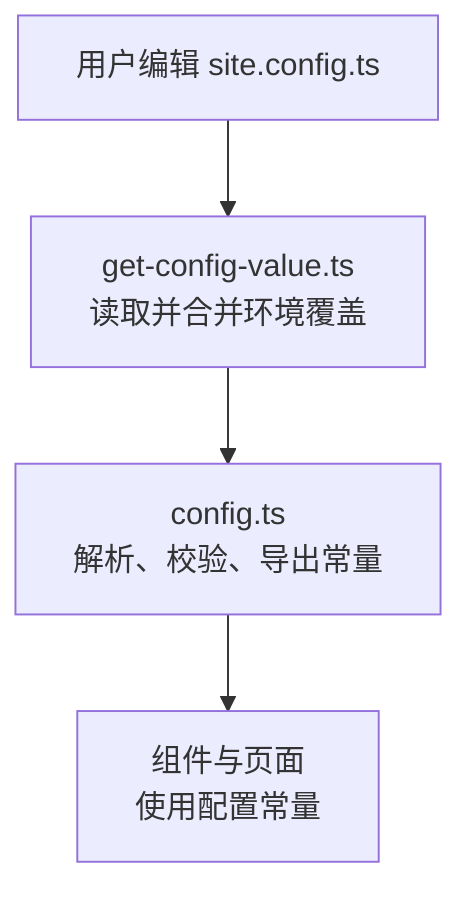
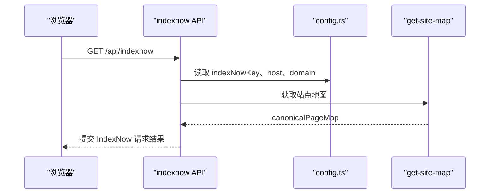
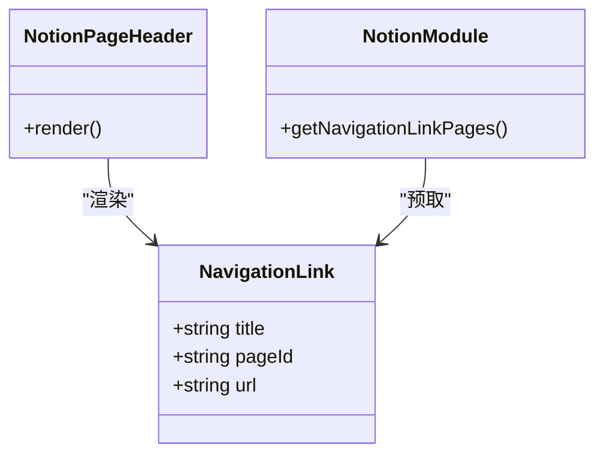
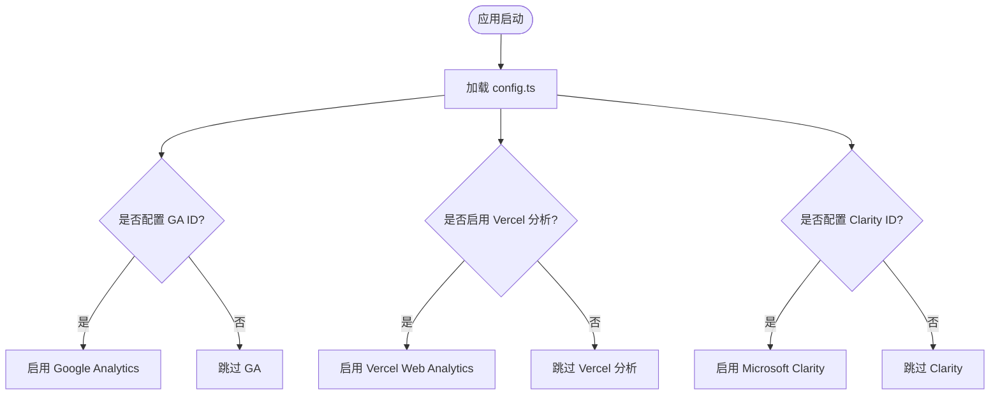
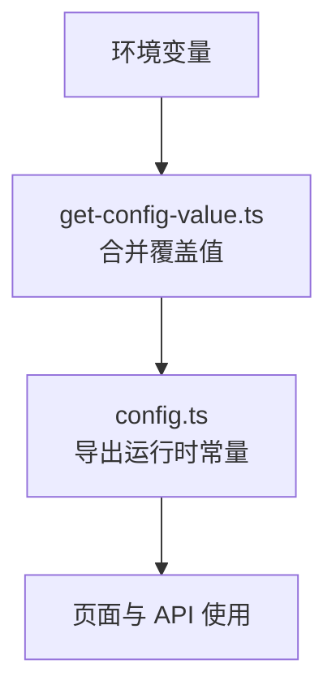
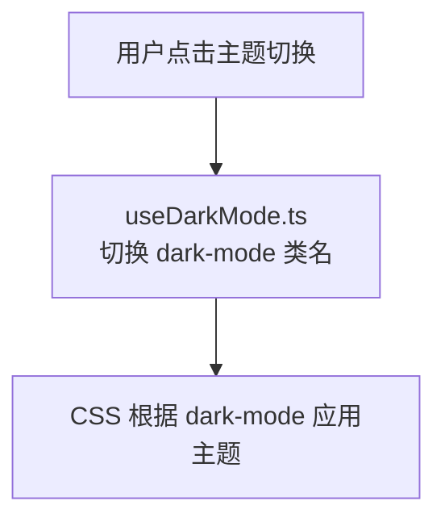
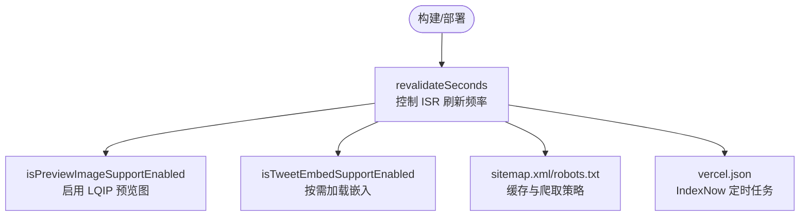
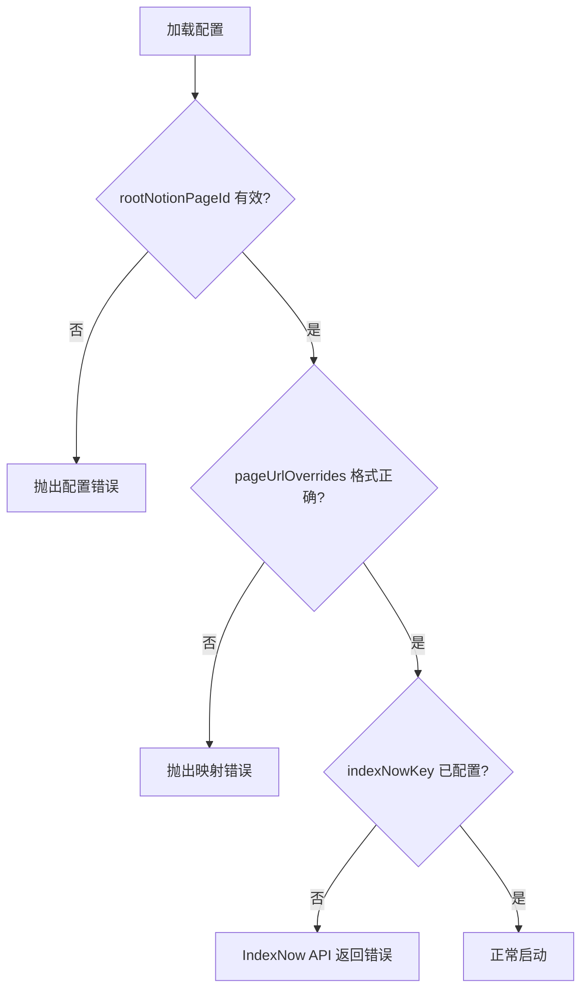

# 配置指南

<cite>
**本文引用的文件**   
- [site.config.ts](file://site.config.ts)
- [lib/site-config.ts](file://lib/site-config.ts)
- [lib/config.ts](file://lib/config.ts)
- [lib/get-config-value.ts](file://lib/get-config-value.ts)
- [lib/types.ts](file://lib/types.ts)
- [components/NotionPageHeader.tsx](file://components/NotionPageHeader.tsx)
- [lib/notion.ts](file://lib/notion.ts)
- [pages/api/indexnow.ts](file://pages/api/indexnow.ts)
- [vercel.json](file://vercel.json)
</cite>

## 目录
1. [简介](#简介)
2. [项目结构与配置加载流程](#项目结构与配置加载流程)
3. [核心配置项总览](#核心配置项总览)
4. [站点元数据与 SEO](#站点元数据与-seo)
5. [导航菜单与页面链接](#导航菜单与页面链接)
6. [社交媒体与分享设置](#社交媒体与分享设置)
7. [分析工具集成](#分析工具集成)
8. [环境变量与运行时配置](#环境变量与运行时配置)
9. [主题与外观定制](#主题与外观定制)
10. [性能优化与缓存策略](#性能优化与缓存策略)
11. [常见配置场景与最佳实践](#常见配置场景与最佳实践)
12. [故障排除指南](#故障排除指南)
13. [结论](#结论)

## 简介
本指南围绕 `site.config.ts` 展开，系统说明站点元数据、导航菜单、社交媒体、分析工具、环境变量、主题定制以及性能优化等配置项的作用与用法。文档同时给出配置示例路径、依赖关系图、流程图和常见问题排查建议，帮助你在不深入源码的情况下完成站点配置与调优。

## 项目结构与配置加载流程
项目的站点配置由以下模块协作完成：
- `site.config.ts`：用户维护的站点配置入口。
- `lib/site-config.ts`：定义配置类型与结构。
- `lib/get-config-value.ts`：读取并合并 `site.config.ts` 与环境变量覆盖值，提供统一访问方法。
- `lib/config.ts`：将配置转换为应用级常量，并进行校验、转换与导出。
- `lib/types.ts`：共享类型定义（如导航样式、URL 映射等）。

**图表来源**
- [site.config.ts:1-77](file://site.config.ts#L1-L77)
- [lib/site-config.ts:1-56](file://lib/site-config.ts#L1-L56)
- [lib/get-config-value.ts:1-73](file://lib/get-config-value.ts#L1-L73)
- [lib/config.ts:1-221](file://lib/config.ts#L1-L221)

**章节来源**
- [site.config.ts:1-77](file://site.config.ts#L1-L77)
- [lib/site-config.ts:1-56](file://lib/site-config.ts#L1-L56)
- [lib/get-config-value.ts:1-73](file://lib/get-config-value.ts#L1-L73)
- [lib/config.ts:1-221](file://lib/config.ts#L1-L221)

## 核心配置项总览
以下为 `site.config.ts` 中所有可配置项的分类说明。每个条目均包含用途、默认行为、是否必填、以及与运行时的关联。

- 站点基础信息
  - rootNotionPageId：根 Notion 页面 ID，必填。用于确定站点首页内容。
  - rootNotionSpaceId：限制为单一 Notion 工作区 ID，可选。
  - name：站点名称，必填。
  - domain：站点域名，必填。
  - author：作者名，必填。
  - description：站点描述，可选。用于 SEO 与社交分享摘要。
  - language：语言代码，可选，默认 en。

- Notion 页面默认视觉
  - defaultPageIcon：全站默认图标，可选。
  - defaultPageCover：全站默认封面，可选。
  - defaultPageCoverPosition：封面垂直位置比例，可选。

- 预览与嵌入
  - isPreviewImageSupportEnabled：启用 LQIP 预览图支持，可选。
  - isTweetEmbedSupportEnabled：启用推文嵌入支持，可选。

- SEO 与搜索引擎验证
  - googleSiteVerification：Google Search Console 验证码，可选。
  - bingSiteVerification：Bing Webmaster Tools 验证码，可选。
  - indexNowKey：IndexNow 密钥，可选；需在 public 目录下放置同名 txt 文件。

- 分析工具
  - googleAnalyticsId：Google Analytics 4 测量 ID，可选。
  - isVercelAnalyticsEnabled：启用 Vercel Web Analytics，可选。
  - isVercelSpeedInsightsEnabled：启用 Vercel Speed Insights，可选。
  - clarityId：Microsoft Clarity 项目 ID，可选。

- URL 与导航
  - includeNotionIdInUrls：是否在 URL 中包含 Notion ID，可选，开发模式默认开启。
  - pageUrlOverrides：自定义 URL 到 Notion 页面 ID 的映射，可选。
  - pageUrlAdditions：额外 URL 映射，可选。
  - navigationStyle：导航样式，可选，default 或 custom。
  - navigationLinks：自定义导航链接数组，可选。

- ISR 与性能
  - revalidateSeconds：ISR 重新验证间隔秒数，可选，默认 3600。

**章节来源**
- [lib/site-config.ts:3-45](file://lib/site-config.ts#L3-L45)
- [lib/types.ts:7-45](file://lib/types.ts#L7-L45)
- [lib/config.ts:23-95](file://lib/config.ts#L23-L95)

## 站点元数据与 SEO
- 站点元数据
  - name、domain、author、description、language 会作为站点基本信息导出，供页面头部、SEO 标签与社交分享使用。
- SEO 验证
  - googleSiteVerification 与 bingSiteVerification 可从 site.config.ts 读取，也可通过环境变量覆盖。
  - indexNowKey 用于即时索引服务；当未配置时，相关 API 会返回错误提示。
- 社交分享图片
  - 站点可通过 API 生成社交分享图片，URL 构建逻辑依赖 host 与 api.getSocialImage。

**图表来源**
- [pages/api/indexnow.ts:1-50](file://pages/api/indexnow.ts#L1-L50)
- [lib/config.ts:114-128](file://lib/config.ts#L114-L128)

**章节来源**
- [lib/config.ts:114-128](file://lib/config.ts#L114-L128)
- [pages/api/indexnow.ts:1-50](file://pages/api/indexnow.ts#L1-L50)

## 导航菜单与页面链接
- 导航样式
  - navigationStyle 支持 default 与 custom。选择 custom 后，可使用 navigationLinks 定义顶部导航。
- 导航链接
  - navigationLinks 是数组，每项包含 title、pageId 或 url。若仅含 pageId，则链接到站内 Notion 页面；若含 url，则为外部链接。
- 渲染逻辑
  - 在 NotionPageHeader 中，navigationLinks 被遍历并渲染为按钮式链接；同时显示主题切换与搜索按钮。
- 预取逻辑
  - notion.ts 会根据 navigationStyle 与 navigationLinks 中的 pageId 批量预取页面信息，提升交互体验。

**图表来源**
- [lib/site-config.ts:47-51](file://lib/site-config.ts#L47-L51)
- [components/NotionPageHeader.tsx:93-132](file://components/NotionPageHeader.tsx#L93-L132)
- [lib/notion.ts:57-81](file://lib/notion.ts#L57-L81)

**章节来源**
- [lib/site-config.ts:39-51](file://lib/site-config.ts#L39-L51)
- [components/NotionPageHeader.tsx:93-132](file://components/NotionPageHeader.tsx#L93-L132)
- [lib/notion.ts:57-81](file://lib/notion.ts#L57-L81)

## 社交媒体与分享设置
- 当前仓库未提供专门的“社交媒体账号”配置项（如 Twitter/Facebook/LinkedIn 账号 URL）。
- 前端存在多个社交平台图标组件（Twitter、LinkedIn、Mastodon、Zhihu、GitHub、YouTube 等），但它们的展示通常由页面内容或组件内部逻辑决定，而非集中配置。
- 如需在站点中添加社交账号链接，建议在 Notion 页面内容或自定义导航中使用 navigationLinks 的外部链接方式实现。

[本节为概念性说明，不直接分析具体文件]

## 分析工具集成
- Google Analytics 4
  - googleAnalyticsId 可在 site.config.ts 中配置，或通过 NEXT_PUBLIC_GOOGLE_ANALYTICS_ID 环境变量覆盖。
- Vercel 分析
  - isVercelAnalyticsEnabled 与 isVercelSpeedInsightsEnabled 控制是否启用 Vercel Web Analytics 与 Speed Insights。
- Microsoft Clarity
  - clarityId 用于接入 Clarity 热图与录制功能。

**图表来源**
- [lib/config.ts:130-143](file://lib/config.ts#L130-L143)
- [lib/site-config.ts:28-33](file://lib/site-config.ts#L28-L33)

**章节来源**
- [lib/config.ts:130-143](file://lib/config.ts#L130-L143)
- [lib/site-config.ts:28-33](file://lib/site-config.ts#L28-L33)

## 环境变量与运行时配置
- 环境变量覆盖
  - NEXT_PUBLIC_SITE_CONFIG：以 JSON 形式覆盖 site.config.ts 中的字段，便于在不同环境快速调整。
  - GOOGLE_SITE_VERIFICATION、BING_SITE_VERIFICATION、INDEXNOW_KEY：分别覆盖对应 SEO 验证与 IndexNow 密钥。
  - NEXT_PUBLIC_GOOGLE_ANALYTICS_ID：覆盖 Google Analytics 测量 ID。
  - PORT、VERCEL_URL：影响本地开发与生产环境的 host 与 apiHost。
- 运行时常量
  - environment、isDev、port、host、apiHost、apiBaseUrl 由 config.ts 计算得出，供页面与 API 使用。

**图表来源**
- [lib/get-config-value.ts:8-25](file://lib/get-config-value.ts#L8-L25)
- [lib/config.ts:104-112](file://lib/config.ts#L104-L112)

**章节来源**
- [lib/get-config-value.ts:8-25](file://lib/get-config-value.ts#L8-L25)
- [lib/config.ts:104-112](file://lib/config.ts#L104-L112)

## 主题与外观定制
- 深色模式
  - use-dark-mode.ts 提供深色模式状态与切换函数，默认类名为 dark-mode。
  - 样式文件中针对 dark-mode 定义了代码高亮等主题差异。
- 字体与颜色
  - types.ts 的 Site 接口包含 fontFamily、darkMode、previewImages 等字段，可用于扩展主题能力。
- 导航与社交图标样式
  - components/styles.module.css 定义了社交与设置区域的样式与悬停效果。

**图表来源**
- [lib/use-dark-mode.ts:1-10](file://lib/use-dark-mode.ts#L1-L10)
- [styles/prism-theme.css:98-101](file://styles/prism-theme.css#L98-L101)
- [components/styles.module.css:69-122](file://components/styles.module.css#L69-L122)

**章节来源**
- [lib/use-dark-mode.ts:1-10](file://lib/use-dark-mode.ts#L1-L10)
- [styles/prism-theme.css:98-101](file://styles/prism-theme.css#L98-L101)
- [components/styles.module.css:69-122](file://components/styles.module.css#L69-L122)

## 性能优化与缓存策略
- ISR 重新验证
  - revalidateSeconds 控制 ISR 页面的重新验证频率；增大该值可减少 Vercel 函数调用次数，适合更新不频繁的站点。
- 预览图与嵌入
  - isPreviewImageSupportEnabled 启用 LQIP 预览图以提升首屏加载体验。
  - isTweetEmbedSupportEnabled 控制是否加载 Twitter 嵌入脚本，按需开启以减少第三方资源开销。
- 站点地图与爬虫
  - sitemap.xml 与 robots.txt 设置了合理的缓存头与爬取规则，避免重复内容与 API 暴露。
- IndexNow 定时任务
  - vercel.json 配置了定时任务，定期调用 /api/indexnow 向搜索引擎提交站点更新。

**图表来源**
- [lib/config.ts:93-95](file://lib/config.ts#L93-L95)
- [lib/config.ts:68-72](file://lib/config.ts#L68-L72)
- [lib/config.ts:90-91](file://lib/config.ts#L90-L91)
- [pages/sitemap.xml.tsx:18-26](file://pages/sitemap.xml.tsx#L18-L26)
- [pages/robots.txt.tsx:17-21](file://pages/robots.txt.tsx#L17-L21)
- [vercel.json:1-9](file://vercel.json#L1-L9)

**章节来源**
- [lib/config.ts:68-95](file://lib/config.ts#L68-L95)
- [pages/sitemap.xml.tsx:18-26](file://pages/sitemap.xml.tsx#L18-L26)
- [pages/robots.txt.tsx:17-21](file://pages/robots.txt.tsx#L17-L21)
- [vercel.json:1-9](file://vercel.json#L1-L9)

## 常见配置场景与最佳实践
- 设置个人博客
  - 填写 name、domain、author、description。
  - 配置 rootNotionPageId 指向你的 Notion 首页。
  - 根据需要开启 isPreviewImageSupportEnabled 提升首屏体验。
- 自定义导航菜单
  - 将 navigationStyle 设为 custom，并在 navigationLinks 中添加标题与 pageId 或 url。
  - 确保 pageId 有效且公开可见，避免 404。
- 接入搜索引擎验证
  - 在 site.config.ts 中填入 googleSiteVerification 与 bingSiteVerification。
  - 如需即时索引，配置 indexNowKey 并将对应的 txt 文件放入 public 目录。
- 启用分析工具
  - 配置 googleAnalyticsId 与/或开启 isVercelAnalyticsEnabled、isVercelSpeedInsightsEnabled。
  - 如需热图与录制，配置 clarityId。
- 调整 ISR 刷新频率
  - 对于低频更新站点，增大 revalidateSeconds（例如 86400）以减少函数调用。
  - 对于高频更新站点，保持较低值以获得更及时的内容。

[本节为通用指导，不直接分析具体文件]

## 故障排除指南
- 缺少必填配置
  - 如果 rootNotionPageId、name、domain、author 缺失，会在加载阶段抛出错误。请检查 site.config.ts 是否正确导出。
- 无效 Notion ID
  - pageUrlOverrides 或 pageUrlAdditions 中的 Notion ID 必须为有效 UUID；否则会在清理映射时报错。
- URL 映射格式错误
  - pageUrlOverrides 的值必须以 "/" 开头；否则会报无效相对 URI 的错误。
- IndexNow 未配置
  - 访问 /api/indexnow 时会返回错误提示，需配置 indexNowKey 并确保 public 目录下存在同名 txt 文件。
- 环境变量解析失败
  - NEXT_PUBLIC_SITE_CONFIG 必须是合法 JSON；否则解析失败并抛出错误。
- 必需环境变量缺失
  - 在服务器端调用 getEnv 时，若缺少必需的环境变量，会抛出错误；请在部署平台正确设置。

**图表来源**
- [lib/config.ts:23-44](file://lib/config.ts#L23-L44)
- [lib/config.ts:174-207](file://lib/config.ts#L174-L207)
- [pages/api/indexnow.ts:23-27](file://pages/api/indexnow.ts#L23-L27)
- [lib/get-config-value.ts:4-20](file://lib/get-config-value.ts#L4-L20)
- [lib/get-config-value.ts:52-72](file://lib/get-config-value.ts#L52-L72)

**章节来源**
- [lib/config.ts:23-44](file://lib/config.ts#L23-L44)
- [lib/config.ts:174-207](file://lib/config.ts#L174-L207)
- [pages/api/indexnow.ts:23-27](file://pages/api/indexnow.ts#L23-L27)
- [lib/get-config-value.ts:4-20](file://lib/get-config-value.ts#L4-L20)
- [lib/get-config-value.ts:52-72](file://lib/get-config-value.ts#L52-L72)

## 结论
通过 `site.config.ts` 与配套的配置模块，你可以灵活地管理站点元数据、导航菜单、社交媒体与分享、分析工具、环境变量、主题外观以及性能优化。建议在生产环境中优先保证必填配置的正确性，按需启用分析工具与预览图，合理设置 ISR 刷新频率，并通过环境变量进行差异化配置。遇到问题时，依据本指南的故障排除步骤定位并修复配置错误。