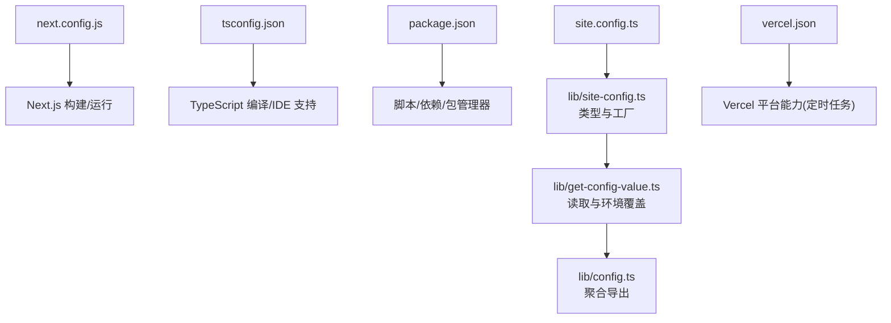
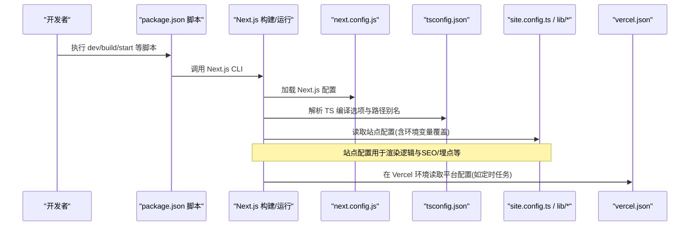
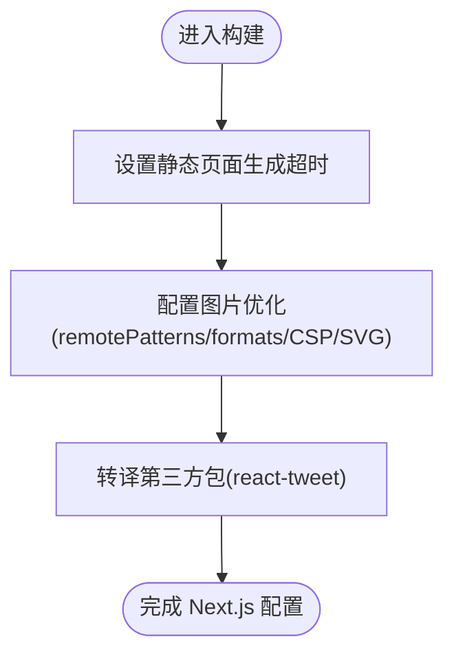
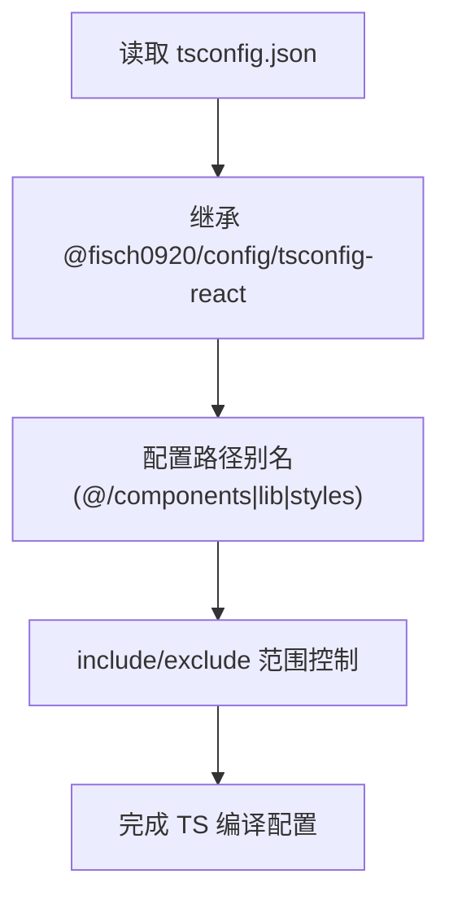
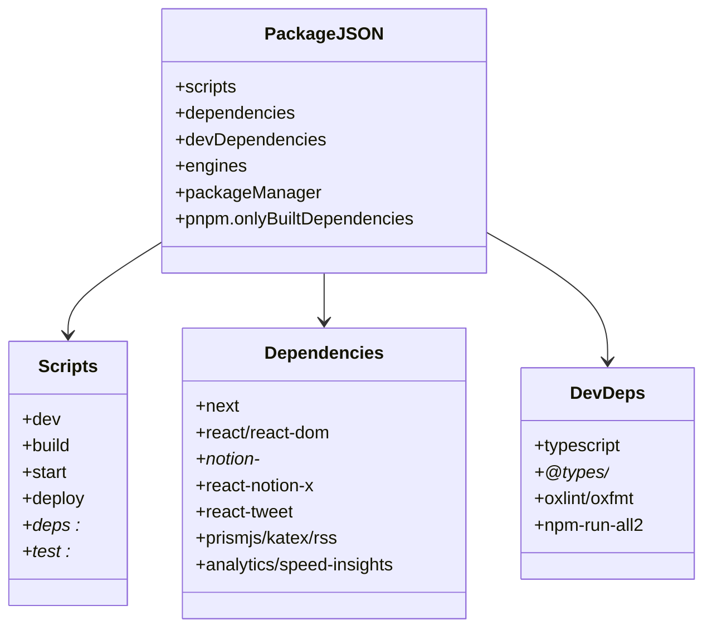
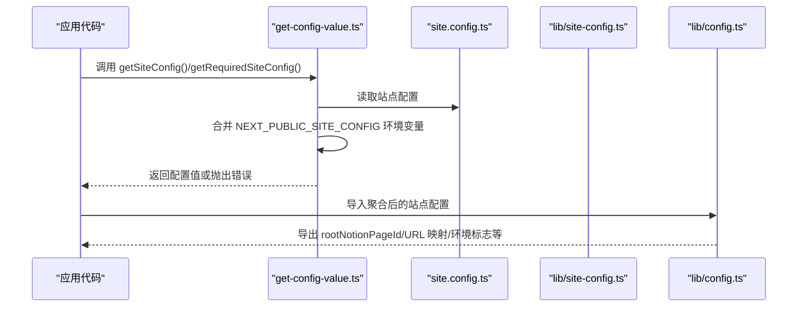
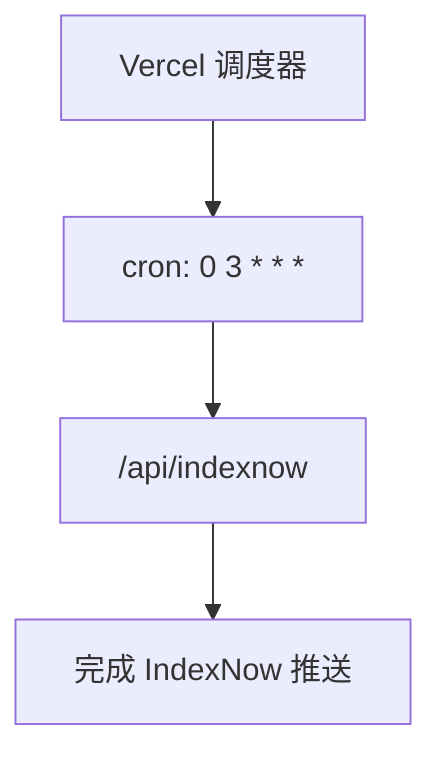
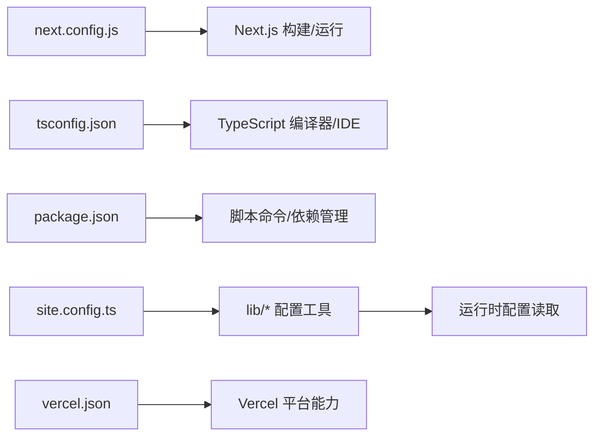

# 框架配置

<cite>
**本文引用的文件**   
- [next.config.js](file://next.config.js)
- [tsconfig.json](file://tsconfig.json)
- [package.json](file://package.json)
- [site.config.ts](file://site.config.ts)
- [lib/site-config.ts](file://lib/site-config.ts)
- [lib/get-config-value.ts](file://lib/get-config-value.ts)
- [lib/config.ts](file://lib/config.ts)
- [vercel.json](file://vercel.json)
</cite>

## 目录
1. [简介](#简介)
2. [项目结构](#项目结构)
3. [核心组件](#核心组件)
4. [架构总览](#架构总览)
5. [详细组件分析](#详细组件分析)
6. [依赖关系分析](#依赖关系分析)
7. [性能与优化建议](#性能与优化建议)
8. [故障排查指南](#故障排查指南)
9. [结论](#结论)

## 简介
本文件面向使用 Next.js + TypeScript 的站点工程，系统性说明以下配置：
- Next.js 框架配置（构建优化、图片远程源、CSP、包转译等）
- TypeScript 编译配置（目标版本、模块系统、严格模式、路径别名等）
- 项目元数据与脚本命令（package.json）
- 站点运行时配置（site.config.ts 及其类型与读取机制）
- Vercel 部署相关配置（定时任务）

同时给出配置文件之间的关系图、关键流程时序图、以及可操作的优化与排错建议。

## 项目结构
本项目采用典型的 Next.js 应用结构，并引入 Notion 作为内容来源。与“框架配置”直接相关的顶层文件包括：
- next.config.js：Next.js 构建与运行期配置
- tsconfig.json：TypeScript 编译与路径映射
- package.json：脚本、依赖、包管理器与引擎约束
- site.config.ts：站点业务配置入口
- lib/site-config.ts：站点配置的类型定义与工厂函数
- lib/get-config-value.ts：站点配置的读取与环境变量覆盖
- lib/config.ts：聚合后的站点配置导出
- vercel.json：Vercel 平台级配置（如定时任务）

图表来源
- [next.config.js:1-43](file://next.config.js#L1-L43)
- [tsconfig.json:1-13](file://tsconfig.json#L1-L13)
- [package.json:1-94](file://package.json#L1-L94)
- [site.config.ts:1-78](file://site.config.ts#L1-L78)
- [lib/site-config.ts:1-56](file://lib/site-config.ts#L1-L56)
- [lib/get-config-value.ts:1-72](file://lib/get-config-value.ts#L1-L72)
- [lib/config.ts:1-49](file://lib/config.ts#L1-L49)
- [vercel.json:1-10](file://vercel.json#L1-L10)

章节来源
- [next.config.js:1-43](file://next.config.js#L1-L43)
- [tsconfig.json:1-13](file://tsconfig.json#L1-L13)
- [package.json:1-94](file://package.json#L1-L94)
- [site.config.ts:1-78](file://site.config.ts#L1-L78)
- [lib/site-config.ts:1-56](file://lib/site-config.ts#L1-L56)
- [lib/get-config-value.ts:1-72](file://lib/get-config-value.ts#L1-L72)
- [lib/config.ts:1-49](file://lib/config.ts#L1-L49)
- [vercel.json:1-10](file://vercel.json#L1-L10)

## 核心组件
本节聚焦与“框架配置”直接相关的核心文件与职责：
- next.config.js：Next.js 构建期与运行期行为控制（静态页面超时、图片优化、CSP、包转译）
- tsconfig.json：TS 编译选项、路径别名、包含/排除范围
- package.json：脚本命令、依赖版本、包管理器与 Node 引擎约束
- site.config.ts + lib/*：站点配置的定义、读取与合并策略
- vercel.json：Vercel 平台能力（定时任务）

章节来源
- [next.config.js:1-43](file://next.config.js#L1-L43)
- [tsconfig.json:1-13](file://tsconfig.json#L1-L13)
- [package.json:1-94](file://package.json#L1-L94)
- [site.config.ts:1-78](file://site.config.ts#L1-L78)
- [lib/site-config.ts:1-56](file://lib/site-config.ts#L1-L56)
- [lib/get-config-value.ts:1-72](file://lib/get-config-value.ts#L1-L72)
- [lib/config.ts:1-49](file://lib/config.ts#L1-L49)
- [vercel.json:1-10](file://vercel.json#L1-L10)

## 架构总览
下图展示“框架配置”在构建与运行时的作用域与交互关系：

图表来源
- [package.json:10-26](file://package.json#L10-L26)
- [next.config.js:1-43](file://next.config.js#L1-L43)
- [tsconfig.json:1-13](file://tsconfig.json#L1-L13)
- [site.config.ts:1-78](file://site.config.ts#L1-L78)
- [lib/get-config-value.ts:1-72](file://lib/get-config-value.ts#L1-L72)
- [vercel.json:1-10](file://vercel.json#L1-L10)

## 详细组件分析

### Next.js 框架配置（next.config.js）
- 静态页面生成超时：通过 staticPageGenerationTimeout 延长构建时静态页面的生成时间，避免大型站点或复杂 ISR 场景下超时失败。
- 图片优化与远程源：
  - remotePatterns 允许来自 Notion CDN、AWS、Unsplash、Twitter 等域名下的 HTTPS 图片被 Next.js 图片优化器处理；同时开放任意 https 主机名以兼容 Notion 中嵌入的外部图片。
  - formats 指定优先输出 AVIF/WebP 以提升加载性能。
  - dangerouslyAllowSVG 开启 SVG 图片支持。
  - contentSecurityPolicy 设置严格的 CSP，限制脚本执行与沙箱化，提升安全性。
- Webpack 自定义：示例代码注释展示了如何通过 webpack 配置解决 react/react-dom 解析问题（本地链接第三方库时），当前未启用。
- 包转译：transpilePackages 将 react-tweet 纳入转译，确保在 Next.js 环境中正确运行。

图表来源
- [next.config.js:4-42](file://next.config.js#L4-L42)

章节来源
- [next.config.js:1-43](file://next.config.js#L1-L43)

### TypeScript 编译配置（tsconfig.json）
- 继承外部配置：extends 指向 @fisch0920/config/tsconfig-react，复用团队/社区推荐的 React + TS 基础配置。
- 路径别名：paths 定义了 @/components、@/lib、@/styles 的映射，便于在代码中以绝对路径引用。
- include/exclude：包含 next-env.d.ts、所有 .ts/.tsx 与 *.config.ts，排除 node_modules。

注意：由于 extends 了外部 tsconfig，具体的 target/module/moduleResolution/strict 等由该外部配置提供。若需调整，可在当前 tsconfig.json 的 compilerOptions 中覆盖相应字段。

图表来源
- [tsconfig.json:1-13](file://tsconfig.json#L1-L13)

章节来源
- [tsconfig.json:1-13](file://tsconfig.json#L1-L13)

### 项目元数据与脚本（package.json）
- 元信息：name、version、private、description、license、author、repository、type=module。
- 脚本命令：
  - dev/build/start：Next.js 开发/构建/生产启动
  - deploy：Vercel 部署
  - deps:upgrade/deps:link/deps:unlink：依赖升级与本地链接 notion-* 包的辅助脚本
  - test：并行执行 lint/format/typecheck
  - test:lint/test:format/test:typecheck：分别执行 oxlint、oxfmt、tsc
- 依赖：
  - 运行时依赖：next、react、react-dom、notion-client/types/utils、react-notion-x、react-tweet、prismjs、katex、rss、analytics/speed-insights 等
  - 开发依赖：typescript、@types/*、oxlint/oxfmt、npm-run-all2 等
- 包管理与引擎：
  - engines.node=24，packageManager=pnpm@10.29.3
  - pnpm.onlyBuiltDependencies 仅构建必要原生依赖，减少安装体积与时间

图表来源
- [package.json:1-94](file://package.json#L1-L94)

章节来源
- [package.json:1-94](file://package.json#L1-L94)

### 站点运行时配置（site.config.ts 与 lib/*）
- site.config.ts：站点业务配置入口，包含 Notion 根页面 ID、站点名称/域名/作者、描述、默认图标/封面、预览图开关、搜索引擎验证码、IndexNow key、分析服务开关、URL 重写、ISR revalidateSeconds、导航样式等。
- lib/site-config.ts：定义 SiteConfig 接口与 NavigationLink 类型，并提供 siteConfig 工厂函数进行类型校验与返回。
- lib/get-config-value.ts：从 site.config.ts 与 NEXT_PUBLIC_SITE_CONFIG 环境变量合并站点配置，提供 getSiteConfig/getRequiredSiteConfig/getEnv 等工具函数，并在缺失必填项时报错。
- lib/config.ts：聚合站点配置，导出 rootNotionPageId、rootNotionSpaceId、pageUrlOverrides/pageUrlAdditions/inversePageUrlOverrides、environment/isDev 等供应用层使用。

图表来源
- [site.config.ts:1-78](file://site.config.ts#L1-L78)
- [lib/site-config.ts:1-56](file://lib/site-config.ts#L1-L56)
- [lib/get-config-value.ts:1-72](file://lib/get-config-value.ts#L1-L72)
- [lib/config.ts:1-49](file://lib/config.ts#L1-L49)

章节来源
- [site.config.ts:1-78](file://site.config.ts#L1-L78)
- [lib/site-config.ts:1-56](file://lib/site-config.ts#L1-L56)
- [lib/get-config-value.ts:1-72](file://lib/get-config-value.ts#L1-L72)
- [lib/config.ts:1-49](file://lib/config.ts#L1-L49)

### Vercel 平台配置（vercel.json）
- 定义 crons 定时任务，每天凌晨 3 点触发 /api/indexnow，用于向 Bing/Yandex 推送索引更新。

图表来源
- [vercel.json:1-10](file://vercel.json#L1-L10)

章节来源
- [vercel.json:1-10](file://vercel.json#L1-L10)

## 依赖关系分析
- next.config.js 与 Next.js 构建管线耦合，影响静态页面生成、图片优化、CSP 与第三方包转译。
- tsconfig.json 与 IDE/编译器耦合，决定路径别名与编译行为；具体严格模式/目标版本由继承的外部配置提供。
- package.json 是脚本与依赖的单一事实来源，驱动 dev/build/start/test 等流程。
- site.config.ts 与 lib/* 共同构成站点配置体系，并通过环境变量实现运行时覆盖。
- vercel.json 仅在 Vercel 平台生效，影响部署与定时任务。

图表来源
- [next.config.js:1-43](file://next.config.js#L1-L43)
- [tsconfig.json:1-13](file://tsconfig.json#L1-L13)
- [package.json:1-94](file://package.json#L1-L94)
- [site.config.ts:1-78](file://site.config.ts#L1-L78)
- [lib/get-config-value.ts:1-72](file://lib/get-config-value.ts#L1-L72)
- [vercel.json:1-10](file://vercel.json#L1-L10)

章节来源
- [next.config.js:1-43](file://next.config.js#L1-L43)
- [tsconfig.json:1-13](file://tsconfig.json#L1-L13)
- [package.json:1-94](file://package.json#L1-L94)
- [site.config.ts:1-78](file://site.config.ts#L1-L78)
- [lib/get-config-value.ts:1-72](file://lib/get-config-value.ts#L1-L72)
- [vercel.json:1-10](file://vercel.json#L1-L10)

## 性能与优化建议
- 构建与静态页面生成
  - 合理设置 staticPageGenerationTimeout，避免大站点或复杂 ISR 构建超时。
  - 对不常用的第三方包使用 transpilePackages 按需转译，减少打包体积。
- 图片优化
  - 保持 formats 为 AVIF/WebP，结合 CDN 缓存，显著提升首屏加载速度。
  - 谨慎使用 dangerouslyAllowSVG，仅在确有需要时开启。
  - 使用严格的 contentSecurityPolicy 防止 XSS 风险。
- 依赖与包管理
  - 使用 pnpm 与 onlyBuiltDependencies 减少原生依赖构建时间与体积。
  - 锁定 Node 版本（engines.node）与 packageManager，保证环境一致性。
- 站点配置与 ISR
  - 根据内容更新频率调整 revalidateSeconds，平衡新鲜度与函数调用成本。
  - 使用 NEXT_PUBLIC_SITE_CONFIG 环境变量在部署时覆盖站点配置，避免硬编码。
- 平台能力
  - 利用 Vercel cron 定时任务推送索引，提升搜索引擎收录效率。

[本节为通用优化建议，不直接分析具体文件]

## 故障排查指南
- 站点配置缺失或无效
  - 现象：启动或构建时报错提示缺少必填站点配置项。
  - 排查：检查 site.config.ts 是否提供 rootNotionPageId 等必填字段；或通过 NEXT_PUBLIC_SITE_CONFIG 环境变量注入配置。
  - 参考：lib/get-config-value.ts 中的 getRequiredSiteConfig 与 getEnv 的错误抛出逻辑。
- 图片无法加载或优化失败
  - 现象：外部图片显示异常或优化报错。
  - 排查：确认 next.config.js 的 images.remotePatterns 已包含对应域名；必要时临时放宽规则但注意安全风险。
- 第三方包在 Next.js 中运行异常
  - 现象：某些依赖在浏览器端报错。
  - 排查：在 next.config.js 中将对应包加入 transpilePackages，确保其被正确转译。
- 路径别名不生效
  - 现象：IDE 或构建时报找不到模块。
  - 排查：确认 tsconfig.json 的 paths 映射正确，且 include 包含相关文件；必要时重启 IDE。
- 环境变量未生效
  - 现象：NEXT_PUBLIC_SITE_CONFIG 未覆盖预期值。
  - 排查：检查环境变量命名与 JSON 格式是否正确；确认仅在客户端可用的前缀为 NEXT_PUBLIC_。

章节来源
- [lib/get-config-value.ts:1-72](file://lib/get-config-value.ts#L1-L72)
- [next.config.js:6-25](file://next.config.js#L6-L25)
- [next.config.js:40-42](file://next.config.js#L40-L42)
- [tsconfig.json:3-11](file://tsconfig.json#L3-L11)

## 结论
本项目的“框架配置”围绕 Next.js、TypeScript、依赖与站点配置四个维度展开：
- next.config.js 负责构建期与运行期的关键行为控制，尤其是图片优化与 CSP。
- tsconfig.json 通过继承与路径别名简化开发体验，具体编译细节由外部配置提供。
- package.json 统一脚本与依赖，配合 pnpm 与 Node 引擎约束保障环境一致。
- site.config.ts 与 lib/* 形成可扩展的站点配置体系，支持环境变量覆盖与类型安全。
- vercel.json 提供平台级能力（如定时任务）。

遵循本文的配置说明与优化建议，可以在保证稳定性的前提下获得更好的构建性能与运行体验。