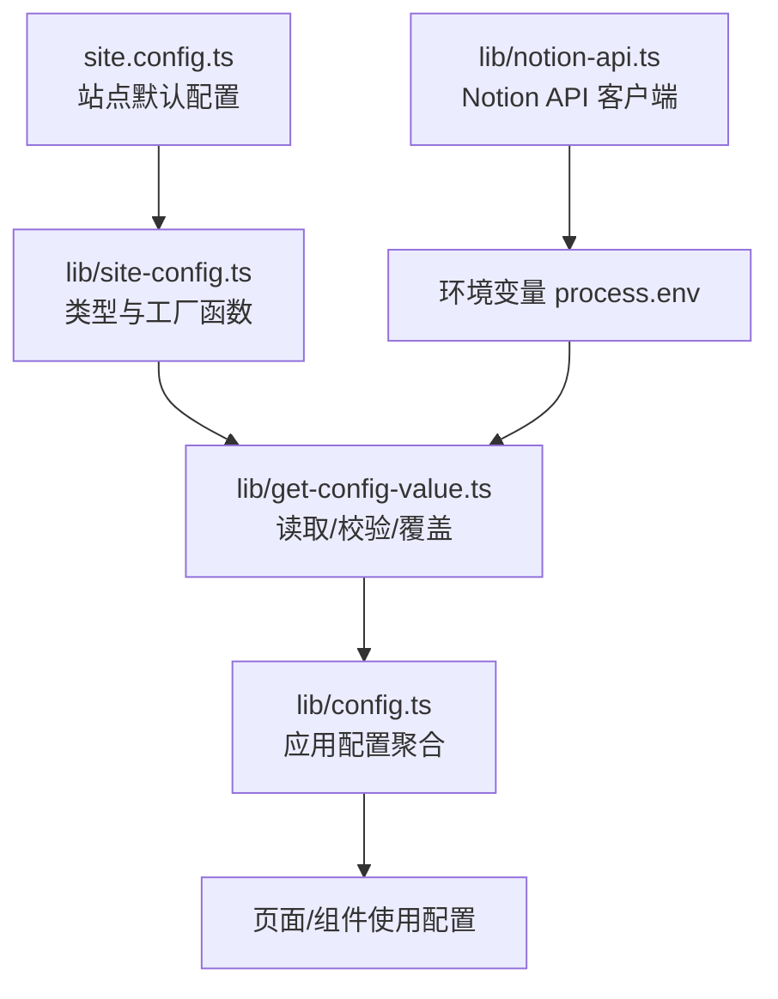
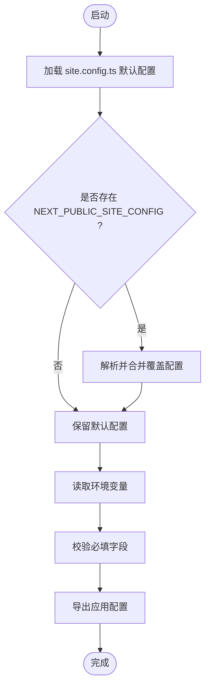
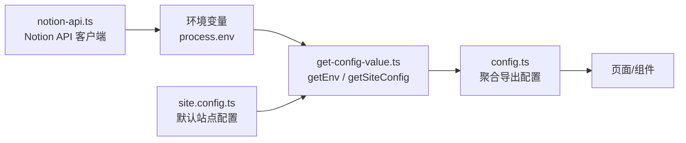
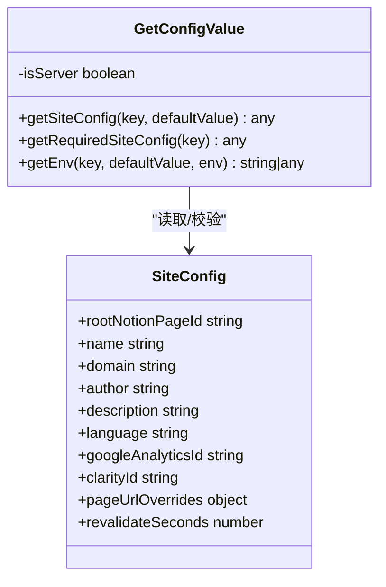
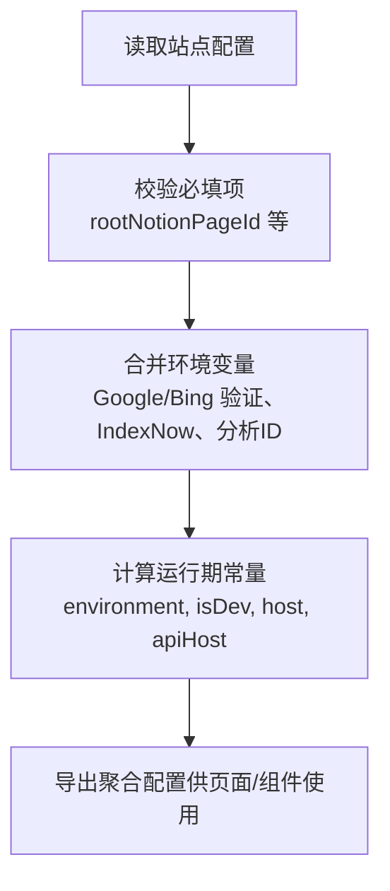
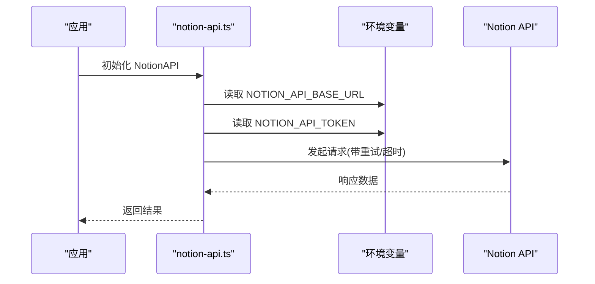
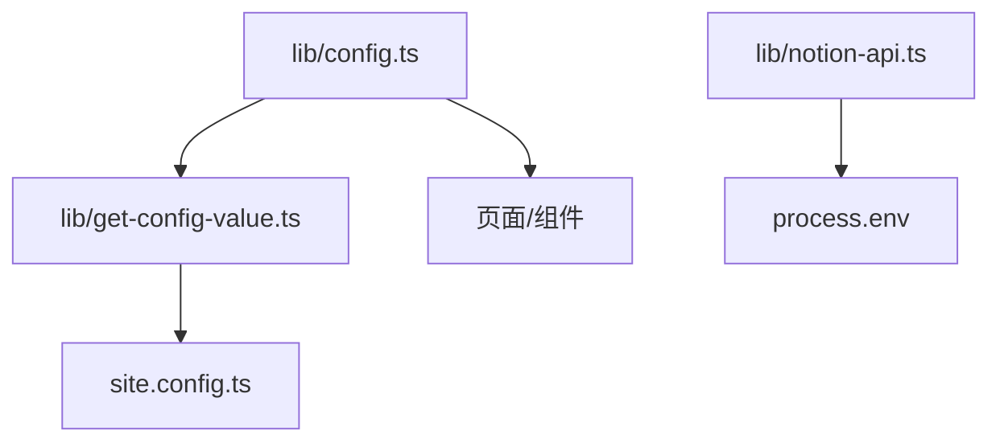

# 环境变量配置

<cite>
**本文引用的文件**   
- [site.config.ts](file://site.config.ts)
- [lib/config.ts](file://lib/config.ts)
- [lib/get-config-value.ts](file://lib/get-config-value.ts)
- [lib/site-config.ts](file://lib/site-config.ts)
- [lib/notion-api.ts](file://lib/notion-api.ts)
</cite>

## 目录
1. [简介](#简介)
2. [项目结构与环境变量位置](#项目结构与环境变量位置)
3. [核心组件与加载机制](#核心组件与加载机制)
4. [架构总览](#架构总览)
5. [详细组件分析](#详细组件分析)
6. [依赖关系分析](#依赖关系分析)
7. [性能与可靠性考量](#性能与可靠性考量)
8. [故障排查指南](#故障排查指南)
9. [结论](#结论)
10. [附录：环境变量清单与示例](#附录环境变量清单与示例)

## 简介
本文档面向开发者与维护者，系统化说明本项目的环境变量体系、加载优先级、覆盖规则以及安全最佳实践。重点涵盖：
- Notion API 认证相关的环境变量（如 NOTION_API_TOKEN）
- 前端可见的前端环境变量（NEXT_PUBLIC_*）
- 站点配置与环境变量的合并策略
- 开发环境与生产环境的配置建议
- 常见问题的定位与解决方案

## 项目结构与环境变量位置
本项目采用“代码内默认值 + 站点配置文件 + 环境变量覆盖”的分层配置模式：
- 默认站点配置定义在 site.config.ts
- 类型与工厂函数定义在 lib/site-config.ts
- 统一读取与校验逻辑在 lib/get-config-value.ts
- 应用级配置聚合与导出在 lib/config.ts
- Notion API 客户端初始化在 lib/notion-api.ts

图表来源
- [site.config.ts:1-78](file://site.config.ts#L1-L78)
- [lib/site-config.ts:1-55](file://lib/site-config.ts#L1-L55)
- [lib/get-config-value.ts:1-73](file://lib/get-config-value.ts#L1-L73)
- [lib/config.ts:1-224](file://lib/config.ts#L1-L224)
- [lib/notion-api.ts:1-20](file://lib/notion-api.ts#L1-L20)

章节来源
- [site.config.ts:1-78](file://site.config.ts#L1-L78)
- [lib/site-config.ts:1-55](file://lib/site-config.ts#L1-L55)
- [lib/get-config-value.ts:1-73](file://lib/get-config-value.ts#L1-L73)
- [lib/config.ts:1-224](file://lib/config.ts#L1-L224)
- [lib/notion-api.ts:1-20](file://lib/notion-api.ts#L1-L20)

## 核心组件与加载机制
本项目的配置加载遵循以下顺序与规则：
1. 站点默认配置：从 site.config.ts 导入默认值
2. 运行时覆盖：通过 NEXT_PUBLIC_SITE_CONFIG 注入 JSON 字符串进行覆盖
3. 环境变量：通过 getEnv 或直接读取 process.env 获取
4. 校验与错误处理：缺失必填项时抛出明确错误

图表来源
- [lib/get-config-value.ts:1-73](file://lib/get-config-value.ts#L1-L73)
- [lib/config.ts:1-224](file://lib/config.ts#L1-L224)

章节来源
- [lib/get-config-value.ts:1-73](file://lib/get-config-value.ts#L1-L73)
- [lib/config.ts:1-224](file://lib/config.ts#L1-L224)

## 架构总览
下图展示环境变量与配置模块的交互关系：

图表来源
- [lib/get-config-value.ts:1-73](file://lib/get-config-value.ts#L1-L73)
- [lib/config.ts:1-224](file://lib/config.ts#L1-L224)
- [lib/notion-api.ts:1-20](file://lib/notion-api.ts#L1-L20)
- [site.config.ts:1-78](file://site.config.ts#L1-L78)

## 详细组件分析

### 站点配置与覆盖机制（lib/get-config-value.ts）
- 作用：
  - 加载 site.config.ts 默认配置
  - 支持通过 NEXT_PUBLIC_SITE_CONFIG 以 JSON 字符串形式覆盖部分站点配置
  - 提供 getSiteConfig 与 getRequiredSiteConfig 两种读取方式
  - 提供 getEnv 统一读取环境变量，支持默认值与必填校验
- 关键点：
  - NEXT_PUBLIC_SITE_CONFIG 为可选覆盖入口，便于在不改动代码的情况下调整站点配置
  - getRequiredSiteConfig 在缺失必填项时抛出错误，确保关键配置存在
  - getEnv 在服务端缺失必填环境变量时会抛错，在前端返回空值以避免崩溃

图表来源
- [lib/get-config-value.ts:1-73](file://lib/get-config-value.ts#L1-L73)
- [lib/site-config.ts:1-55](file://lib/site-config.ts#L1-L55)

章节来源
- [lib/get-config-value.ts:1-73](file://lib/get-config-value.ts#L1-L73)
- [lib/site-config.ts:1-55](file://lib/site-config.ts#L1-L55)

### 应用配置聚合（lib/config.ts）
- 作用：
  - 汇总站点基础信息、SEO 验证、分析工具 ID、API 地址等
  - 暴露 isDev、environment、host、apiHost、apiBaseUrl 等运行期常量
  - 将部分站点配置与环境变量结合，形成最终可用配置
- 关键点：
  - 使用 getSiteConfig 与 getRequiredSiteConfig 读取站点配置
  - 使用 getEnv 读取环境变量并提供默认值
  - 对 rootNotionPageId 进行严格校验，缺失则抛错
  - 暴露 fathomId、posthogId 等前端可见的分析 ID

图表来源
- [lib/config.ts:1-224](file://lib/config.ts#L1-L224)

章节来源
- [lib/config.ts:1-224](file://lib/config.ts#L1-L224)

### Notion API 客户端（lib/notion-api.ts）
- 作用：
  - 初始化 NotionAPI 客户端
  - 从环境变量读取 NOTION_API_BASE_URL 与 NOTION_API_TOKEN
  - 配置重试策略与超时，提升稳定性
- 关键点：
  - NOTION_API_TOKEN 用于认证访问 Notion API
  - NOTION_API_BASE_URL 可自定义 API 基址（例如代理或私有部署）
  - ofetchOptions 中设置重试次数、延迟、状态码白名单与超时时间

图表来源
- [lib/notion-api.ts:1-20](file://lib/notion-api.ts#L1-L20)

章节来源
- [lib/notion-api.ts:1-20](file://lib/notion-api.ts#L1-L20)

## 依赖关系分析
- 模块耦合：
  - lib/config.ts 依赖 lib/get-config-value.ts 提供的读取与校验能力
  - lib/get-config-value.ts 依赖 site.config.ts 的默认配置
  - lib/notion-api.ts 直接依赖 process.env 中的 Notion 相关变量
- 外部依赖：
  - notion-client 用于调用 Notion API
  - posthog-js 用于 PostHog 分析（仅类型引用）

图表来源
- [lib/config.ts:1-224](file://lib/config.ts#L1-L224)
- [lib/get-config-value.ts:1-73](file://lib/get-config-value.ts#L1-L73)
- [lib/notion-api.ts:1-20](file://lib/notion-api.ts#L1-L20)
- [site.config.ts:1-78](file://site.config.ts#L1-L78)

章节来源
- [lib/config.ts:1-224](file://lib/config.ts#L1-L224)
- [lib/get-config-value.ts:1-73](file://lib/get-config-value.ts#L1-L73)
- [lib/notion-api.ts:1-20](file://lib/notion-api.ts#L1-L20)
- [site.config.ts:1-78](file://site.config.ts#L1-L78)

## 性能与可靠性考量
- Notion API 重试与超时：
  - 通过 ofetchOptions 配置自动重试与超时，避免单次网络抖动导致页面失败
- ISR 重验证间隔：
  - revalidateSeconds 控制页面再生频率，平衡内容新鲜度与函数调用成本
- 前端可见配置最小化：
  - 仅暴露必要的前端可见变量（如分析 ID），减少敏感信息泄露风险

[本节为通用指导，不直接分析具体文件]

## 故障排查指南
- 缺失必填站点配置：
  - 现象：启动时报错提示缺少 required site config value
  - 原因：site.config.ts 未提供必填字段或未通过 NEXT_PUBLIC_SITE_CONFIG 覆盖
  - 解决：补充必填字段或使用 NEXT_PUBLIC_SITE_CONFIG 注入
- 根页面 ID 无效：
  - 现象：报错 invalid "rootNotionPageId"
  - 原因：rootNotionPageId 格式不正确或缺失
  - 解决：检查 site.config.ts 中的 rootNotionPageId 是否为有效 UUID
- 环境变量未生效：
  - 现象：某些功能未按预期启用
  - 原因：环境变量名错误或未被正确读取
  - 解决：核对环境变量名（如 NEXT_PUBLIC_GOOGLE_ANALYTICS_ID、NOTION_API_TOKEN）
- Notion API 认证失败：
  - 现象：调用 Notion API 报 401/403
  - 原因：NOTION_API_TOKEN 缺失或无效
  - 解决：检查环境变量是否正确设置，确认 Token 权限范围
- 前端分析工具未启用：
  - 现象：Fathom 或 PostHog 未工作
  - 原因：NEXT_PUBLIC_FATHOM_ID 或 NEXT_PUBLIC_POSTHOG_ID 未设置
  - 解决：在运行环境中设置对应的前端可见环境变量

章节来源
- [lib/config.ts:23-30](file://lib/config.ts#L23-L30)
- [lib/get-config-value.ts:40-48](file://lib/get-config-value.ts#L40-L48)
- [lib/notion-api.ts:6-9](file://lib/notion-api.ts#L6-L9)

## 结论
本项目通过“默认站点配置 + 运行时覆盖 + 环境变量”的分层机制实现灵活且安全的配置管理。Notion API 认证与分析工具 ID 分别通过服务端与前端可见环境变量注入，配合严格的必填校验与重试策略，保障系统的稳定性与可维护性。建议在开发与生产环境分别维护环境变量，遵循最小暴露原则与安全最佳实践。

[本节为总结性内容，不直接分析具体文件]

## 附录：环境变量清单与示例

### 环境变量清单与用途
- NOTION_API_TOKEN
  - 用途：Notion API 认证令牌
  - 读取位置：lib/notion-api.ts
  - 是否前端可见：否
- NOTION_API_BASE_URL
  - 用途：自定义 Notion API 基址（可选）
  - 读取位置：lib/notion-api.ts
  - 是否前端可见：否
- NEXT_PUBLIC_GOOGLE_ANALYTICS_ID
  - 用途：Google Analytics 4 测量 ID（可选）
  - 读取位置：lib/config.ts
  - 是否前端可见：是
- NEXT_PUBLIC_FATHOM_ID
  - 用途：Fathom 分析 ID（可选）
  - 读取位置：lib/config.ts
  - 是否前端可见：是
- NEXT_PUBLIC_POSTHOG_ID
  - 用途：PostHog 项目 ID（可选）
  - 读取位置：lib/config.ts
  - 是否前端可见：是
- NEXT_PUBLIC_SITE_CONFIG
  - 用途：以 JSON 字符串形式覆盖站点配置（可选）
  - 读取位置：lib/get-config-value.ts
  - 是否前端可见：是
- GOOGLE_SITE_VERIFICATION
  - 用途：Google Search Console 站点验证（可选）
  - 读取位置：lib/config.ts
  - 是否前端可见：否
- BING_SITE_VERIFICATION
  - 用途：Bing Webmaster Tools 站点验证（可选）
  - 读取位置：lib/config.ts
  - 是否前端可见：否
- INDEXNOW_KEY
  - 用途：IndexNow 即时索引密钥（可选）
  - 读取位置：lib/config.ts
  - 是否前端可见：否

章节来源
- [lib/notion-api.ts:6-9](file://lib/notion-api.ts#L6-L9)
- [lib/config.ts:117-175](file://lib/config.ts#L117-L175)
- [lib/get-config-value.ts:11-20](file://lib/get-config-value.ts#L11-L20)

### 加载优先级与覆盖规则
- 站点配置优先级：
  - site.config.ts 默认值 < NEXT_PUBLIC_SITE_CONFIG 覆盖 < 环境变量（当配置项允许环境变量覆盖时）
- 环境变量优先级：
  - 若配置项同时存在于站点配置与环境变量，按代码中读取顺序决定最终值
  - 例如：googleAnalyticsId 优先取站点配置，其次取 NEXT_PUBLIC_GOOGLE_ANALYTICS_ID
- 必填校验：
  - 使用 getRequiredSiteConfig 或显式校验（如 rootNotionPageId）确保关键配置存在

章节来源
- [lib/get-config-value.ts:22-48](file://lib/get-config-value.ts#L22-L48)
- [lib/config.ts:23-30](file://lib/config.ts#L23-L30)
- [lib/config.ts:133-146](file://lib/config.ts#L133-L146)

### 开发环境与生产环境配置示例
- 开发环境（本地）：
  - 设置 NOTION_API_TOKEN 与可选的 NOTION_API_BASE_URL
  - 如需启用分析工具，设置 NEXT_PUBLIC_GOOGLE_ANALYTICS_ID、NEXT_PUBLIC_FATHOM_ID、NEXT_PUBLIC_POSTHOG_ID
  - 可通过 NEXT_PUBLIC_SITE_CONFIG 快速覆盖站点配置进行调试
- 生产环境（Vercel 等平台）：
  - 在平台环境变量面板中设置上述所有需要的环境变量
  - 确保 NOTION_API_TOKEN 具备正确的权限范围
  - 谨慎暴露前端可见变量，仅包含必要的分析 ID

[本节为通用指导，不直接分析具体文件]

### .env.local 文件的设置方法
- 在项目根目录创建 .env.local 文件
- 添加所需的环境变量键值对（例如 NOTION_API_TOKEN=your-token）
- 启动开发服务器时，Next.js 会自动加载 .env.local 中的变量
- 注意：不要提交 .env.local 到版本控制系统

[本节为通用指导，不直接分析具体文件]

### 安全最佳实践
- 最小暴露原则：
  - 仅将必要的前端可见变量命名为 NEXT_PUBLIC_*
  - 避免将敏感信息（如 Notion Token）暴露给浏览器
- 环境变量命名规范：
  - 服务端变量：NOTION_API_TOKEN、GOOGLE_SITE_VERIFICATION 等
  - 前端可见变量：NEXT_PUBLIC_GOOGLE_ANALYTICS_ID、NEXT_PUBLIC_FATHOM_ID 等
- 权限控制：
  - Notion Token 应仅授予最小必要权限
  - 定期轮换 Token 并监控异常访问

[本节为通用指导，不直接分析具体文件]