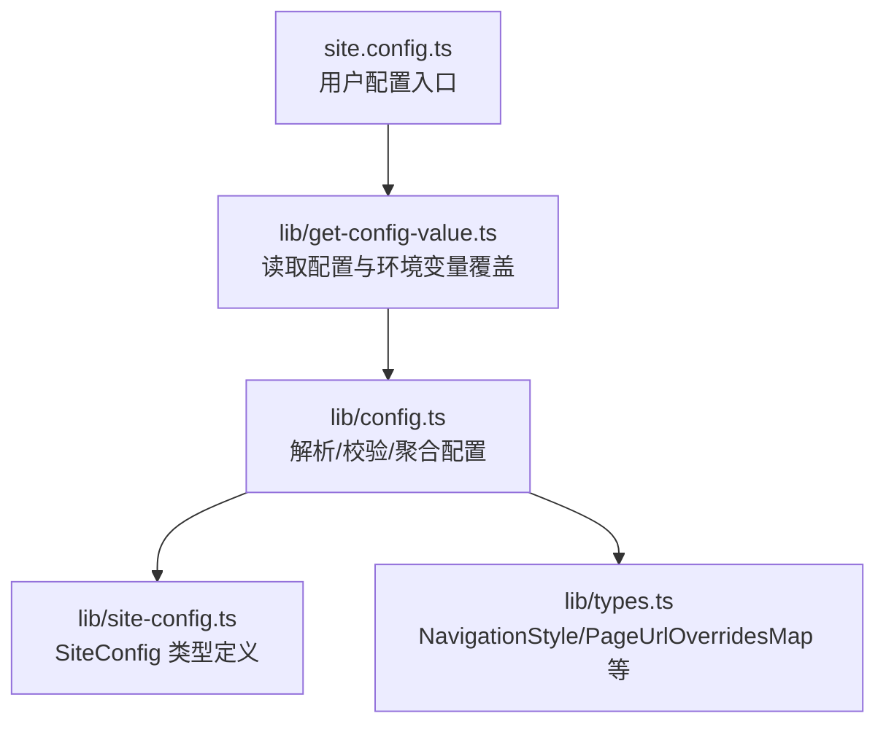
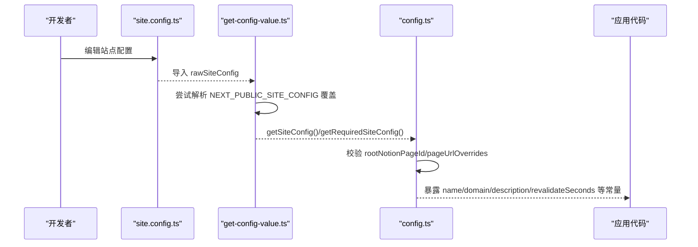
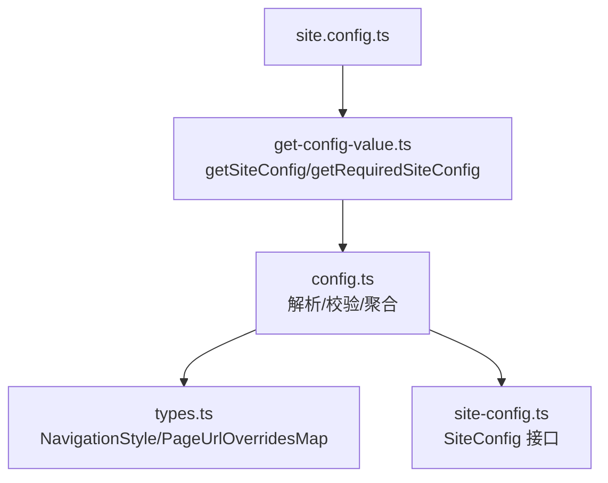

# 站点配置

<cite>
**本文引用的文件**   
- [site.config.ts](file://site.config.ts)
- [lib/site-config.ts](file://lib/site-config.ts)
- [lib/config.ts](file://lib/config.ts)
- [lib/types.ts](file://lib/types.ts)
- [lib/get-config-value.ts](file://lib/get-config-value.ts)
- [readme.md](file://readme.md)
</cite>

## 目录
1. [简介](#简介)
2. [项目结构](#项目结构)
3. [核心组件](#核心组件)
4. [架构总览](#架构总览)
5. [详细配置项说明](#详细配置项说明)
6. [依赖关系分析](#依赖关系分析)
7. [性能与缓存](#性能与缓存)
8. [故障排查](#故障排查)
9. [结论](#结论)

## 简介
本文件面向使用 Next.js + Notion 的站点，聚焦于站点级配置文件 site.config.ts 的所有可选项。内容涵盖：
- Notion 集成相关：根页面、工作区限制等
- 站点基本信息：名称、域名、作者、描述等
- SEO 与搜索引擎验证：Google/Bing 站点验证、IndexNow
- 分析工具集成：GA4、Clarity、Vercel Analytics/Speed Insights
- 页面默认样式：图标、封面图、封面位置
- URL 映射与 ISR 缓存：pageUrlOverrides、revalidateSeconds
- 导航样式与自定义导航链接：navigationStyle、navigationLinks
- 每个配置项的数据类型、默认值、示例与最佳实践

## 项目结构
站点配置由以下模块协同完成：
- site.config.ts：用户维护的站点配置入口
- lib/site-config.ts：SiteConfig 类型定义与导出工厂
- lib/get-config-value.ts：读取 site.config.ts 并支持环境变量覆盖
- lib/config.ts：聚合站点配置、校验、URL 映射处理、暴露运行时常量
- lib/types.ts：NavigationStyle、PageUrlOverridesMap 等类型定义

图示来源
- [site.config.ts:1-78](file://site.config.ts#L1-L78)
- [lib/get-config-value.ts:1-73](file://lib/get-config-value.ts#L1-L73)
- [lib/config.ts:1-224](file://lib/config.ts#L1-L224)
- [lib/site-config.ts:1-56](file://lib/site-config.ts#L1-L56)
- [lib/types.ts:1-78](file://lib/types.ts#L1-L78)

章节来源
- [readme.md:32-48](file://readme.md#L32-L48)

## 核心组件
- SiteConfig 接口：集中声明所有站点配置键及其可选性、类型
- getSiteConfig / getRequiredSiteConfig：统一读取配置，缺失必填项时抛出错误
- config.ts：对配置进行清洗（如 pageUrlOverrides）、合并环境覆盖、输出运行时常量

章节来源
- [lib/site-config.ts:3-55](file://lib/site-config.ts#L3-L55)
- [lib/get-config-value.ts:27-48](file://lib/get-config-value.ts#L27-L48)
- [lib/config.ts:177-223](file://lib/config.ts#L177-L223)

## 架构总览
下图展示从用户配置到运行时常量的数据流，以及关键校验点。

图示来源
- [site.config.ts:1-78](file://site.config.ts#L1-L78)
- [lib/get-config-value.ts:1-73](file://lib/get-config-value.ts#L1-L73)
- [lib/config.ts:23-46](file://lib/config.ts#L23-L46)

## 详细配置项说明

### Notion 集成
- rootNotionPageId
  - 类型：string（必填）
  - 默认值：无
  - 作用：站点根 Notion 页面 ID
  - 示例：'a1b2c3d4...'
  - 行为：在启动时被解析并校验，缺失或无效将抛错
  - 最佳实践：确保该页面已公开分享；仅填写 Notion 页面 ID，不要包含其他路径信息
- rootNotionSpaceId
  - 类型：string | null（可选）
  - 默认值：null
  - 作用：限制站点只访问单个 Notion 工作区
  - 示例：'workspace-id' 或 null
  - 最佳实践：仅在多工作区环境下需要隔离时使用

章节来源
- [site.config.ts:4-9](file://site.config.ts#L4-L9)
- [lib/site-config.ts:4-5](file://lib/site-config.ts#L4-L5)
- [lib/config.ts:23-34](file://lib/config.ts#L23-L34)

### 站点基本信息
- name
  - 类型：string（必填）
  - 默认值：无
  - 作用：站点名称
  - 示例："PhysicalMouse's Blog"
- domain
  - 类型：string（必填）
  - 默认值：无
  - 作用：站点域名，用于构建 API Host、SEO 元信息等
  - 示例："blog.physmouse.com"
- author
  - 类型：string（必填）
  - 默认值：无
  - 作用：站点作者名
  - 示例："PhysicalMouse"
- description
  - 类型：string（可选）
  - 默认值：'Notion Blog'
  - 作用：Open Graph / SEO 描述
  - 示例：中英文混合的站点介绍
  - 最佳实践：控制在 120 字符以内，突出站点主题与价值主张
- language
  - 类型：string（可选）
  - 默认值：'en'
  - 作用：站点语言
  - 示例：'zh-CN'

章节来源
- [site.config.ts:11-18](file://site.config.ts#L11-L18)
- [lib/site-config.ts:7-11](file://lib/site-config.ts#L7-L11)
- [lib/config.ts:52-56](file://lib/config.ts#L52-L56)

### 页面默认样式
- defaultPageIcon
  - 类型：string | null（可选）
  - 默认值：未设置（null）
  - 作用：全站页面默认图标，可被单页覆盖
  - 示例：'📖' 或图片 URL
- defaultPageCover
  - 类型：string | null（可选）
  - 默认值：未设置（null）
  - 作用：全站页面默认封面图，可被单页覆盖
  - 示例：图片 URL
- defaultPageCoverPosition
  - 类型：number | null（可选）
  - 默认值：0.5
  - 作用：封面图裁剪位置比例（0~1）
  - 示例：0.5（居中）

章节来源
- [site.config.ts:20-24](file://site.config.ts#L20-L24)
- [lib/site-config.ts:13-15](file://lib/site-config.ts#L13-L15)
- [lib/config.ts:59-66](file://lib/config.ts#L59-L66)

### 预览图支持
- isPreviewImageSupportEnabled
  - 类型：boolean（可选）
  - 默认值：false
  - 作用：是否启用 LQIP 预览图生成
  - 示例：true
  - 最佳实践：若需提升首屏体验且具备相应存储能力（如 Redis），建议开启

章节来源
- [site.config.ts:26-27](file://site.config.ts#L26-L27)
- [lib/site-config.ts:17](file://lib/site-config.ts#L17)
- [lib/config.ts:68-72](file://lib/config.ts#L68-L72)

### SEO 与搜索引擎验证
- googleSiteVerification
  - 类型：string | null（可选）
  - 默认值：null
  - 作用：Google Search Console HTML 标签验证值
  - 示例：粘贴自 Google 控制台的验证字符串
  - 注意：也可通过环境变量 GOOGLE_SITE_VERIFICATION 覆盖
- bingSiteVerification
  - 类型：string | null（可选）
  - 默认值：null
  - 作用：Bing Webmaster Tools 站点验证
  - 示例：粘贴自 Bing 的验证字符串
  - 注意：也可通过环境变量 BING_SITE_VERIFICATION 覆盖
- indexNowKey
  - 类型：string | null（可选）
  - 默认值：null
  - 作用：IndexNow 密钥，用于 Bing/Yandex 即时收录
  - 示例：'e2d8315e71f04375d6baaa530494bd7c'
  - 要求：public 目录下必须存在同名 .txt 验证文件
  - 注意：也可通过环境变量 INDEXNOW_KEY 覆盖

章节来源
- [site.config.ts:29-37](file://site.config.ts#L29-L37)
- [lib/site-config.ts:21-26](file://lib/site-config.ts#L21-L26)
- [lib/config.ts:117-131](file://lib/config.ts#L117-L131)

### 分析工具集成
- googleAnalyticsId
  - 类型：string | null（可选）
  - 默认值：null
  - 作用：GA4 测量 ID（形如 'G-XXXXXXXXXX'）
  - 示例：'G-NX2G97BYGR'
  - 注意：也可通过环境变量 NEXT_PUBLIC_GOOGLE_ANALYTICS_ID 覆盖
- clarityId
  - 类型：string | null（可选）
  - 默认值：null
  - 作用：Microsoft Clarity 项目 ID
  - 示例：'xsgpgrdvwf'
- isVercelAnalyticsEnabled
  - 类型：boolean（可选）
  - 默认值：true
  - 作用：启用 Vercel Web Analytics
- isVercelSpeedInsightsEnabled
  - 类型：boolean（可选）
  - 默认值：true
  - 作用：启用 Vercel Speed Insights

章节来源
- [site.config.ts:39-46](file://site.config.ts#L39-L46)
- [lib/site-config.ts:28-33](file://lib/site-config.ts#L28-L33)
- [lib/config.ts:133-146](file://lib/config.ts#L133-L146)

### URL 映射与增量静态再生
- pageUrlOverrides
  - 类型：PageUrlOverridesMap | null（可选）
  - 默认值：{}（空映射）
  - 作用：将 Notion 页面 ID 映射到自定义 URL 路径，覆盖默认 URL 生成规则
  - 示例：{ '/about': 'page-id', '/contact': 'page-id' }
  - 校验规则：
    - 值必须是有效的 Notion 页面 ID
    - 键必须以 '/' 开头
    - 内部会清理为相对路径并构建反向映射
  - 最佳实践：仅对重要页面做短路径映射，避免过多覆盖导致维护成本上升
- revalidateSeconds
  - 类型：number（可选）
  - 默认值：3600（秒）
  - 作用：ISR 增量静态再生间隔，控制页面重新生成的频率
  - 示例：86400（每天一次）
  - 权衡：数值越小越新鲜但函数调用越多；数值越大更新越慢但更省资源

章节来源
- [site.config.ts:48-61](file://site.config.ts#L48-L61)
- [lib/site-config.ts:35-37](file://lib/site-config.ts#L35-L37)
- [lib/config.ts:36-46](file://lib/config.ts#L36-L46)
- [lib/config.ts:177-223](file://lib/config.ts#L177-L223)

### 导航样式与自定义导航链接
- navigationStyle
  - 类型：NavigationStyle（可选）
  - 默认值：'default'
  - 取值：'default' | 'custom'
  - 作用：选择默认 Notion 导航或自定义导航
- navigationLinks
  - 类型：Array<NavigationLink>（可选）
  - 默认值：null
  - 作用：当 navigationStyle 为 'custom' 时生效，提供自定义导航项
  - NavigationLink 字段：
    - title：string（必填）
    - pageId：string（可选）
    - url：string（可选）
  - 示例：[{ title: '关于', pageId: 'xxx' }, { title: '联系', url: '/contact' }]
  - 最佳实践：优先使用 pageId 关联 Notion 页面，便于统一管理内容

章节来源
- [site.config.ts:63-76](file://site.config.ts#L63-L76)
- [lib/site-config.ts:39-51](file://lib/site-config.ts#L39-L51)
- [lib/types.ts:7](file://lib/types.ts#L7)
- [lib/config.ts:80-88](file://lib/config.ts#L80-L88)

## 依赖关系分析
- 配置读取链路
  - site.config.ts 导出原始配置
  - get-config-value.ts 加载 site.config.ts，并允许通过 NEXT_PUBLIC_SITE_CONFIG 环境变量进行覆盖
  - config.ts 通过 getSiteConfig/getRequiredSiteConfig 获取配置，并进行必要校验与转换
- 类型约束
  - site-config.ts 定义 SiteConfig 接口，约束所有可用键与类型
  - types.ts 定义 NavigationStyle、PageUrlOverridesMap 等共用类型

图示来源
- [site.config.ts:1-78](file://site.config.ts#L1-L78)
- [lib/get-config-value.ts:1-73](file://lib/get-config-value.ts#L1-L73)
- [lib/config.ts:1-224](file://lib/config.ts#L1-L224)
- [lib/types.ts:1-78](file://lib/types.ts#L1-L78)
- [lib/site-config.ts:1-56](file://lib/site-config.ts#L1-L56)

章节来源
- [lib/get-config-value.ts:1-73](file://lib/get-config-value.ts#L1-L73)
- [lib/config.ts:1-224](file://lib/config.ts#L1-L224)

## 性能与缓存
- ISR 重验证间隔（revalidateSeconds）
  - 默认 3600 秒，当前仓库设置为 86400 秒（每日一次）
  - 降低函数调用次数，适合内容不频繁更新的站点
  - 如需更高实时性，可适当减小该值
- 预览图（isPreviewImageSupportEnabled）
  - 开启后可提升首屏体验，但可能引入额外存储与计算开销
  - 生产环境建议结合持久化存储（如 Redis）以获得更好性能

章节来源
- [lib/config.ts:93-98](file://lib/config.ts#L93-L98)
- [lib/config.ts:68-72](file://lib/config.ts#L68-L72)

## 故障排查
- 缺少必填配置
  - 现象：启动时报错提示缺少 required site config value
  - 原因：name、domain、author、rootNotionPageId 等必填项未配置
  - 解决：在 site.config.ts 中补充对应字段
- rootNotionPageId 无效
  - 现象：启动时报错 invalid "rootNotionPageId"
  - 原因：ID 格式不正确或未正确解析
  - 解决：检查 Notion 页面 ID 是否正确，并确保页面已公开分享
- pageUrlOverrides 配置错误
  - 现象：启动时报错 Invalid page id / Missing value / should be a relative URI that starts with "/"
  - 原因：映射值不是有效 Notion ID、键不以 '/' 开头或值为空
  - 解决：修正映射键值对，确保键以 '/' 开头且值为有效 Notion 页面 ID
- 环境变量覆盖失败
  - 现象：NEXT_PUBLIC_SITE_CONFIG 无法生效
  - 原因：环境变量 JSON 格式非法
  - 解决：检查环境变量是否为合法 JSON，并符合 SiteConfig 结构

章节来源
- [lib/config.ts:23-34](file://lib/config.ts#L23-L34)
- [lib/config.ts:177-209](file://lib/config.ts#L177-L209)
- [lib/get-config-value.ts:4-20](file://lib/get-config-value.ts#L4-L20)

## 结论
site.config.ts 是站点的单一配置源，配合 lib 层提供的类型与工具函数，实现了强类型、可扩展且可被环境变量覆盖的配置体系。推荐遵循以下原则：
- 明确区分“必填”和“可选”，按需启用功能（如预览图、分析工具）
- 合理使用 pageUrlOverrides 精简 URL，保持导航清晰
- 根据更新频率调整 revalidateSeconds，平衡时效性与成本
- 使用环境变量覆盖敏感配置（如站点验证、分析 ID），避免硬编码