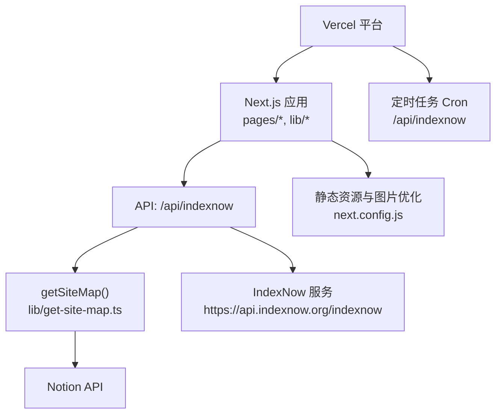
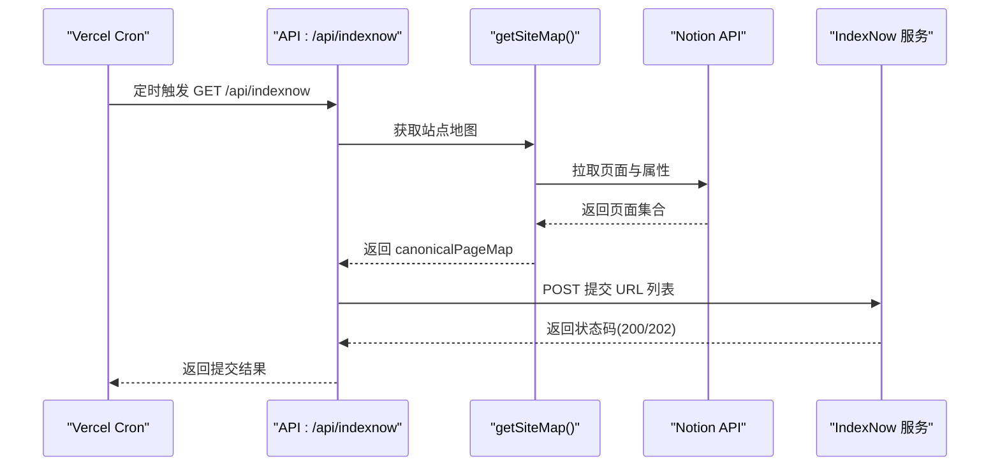
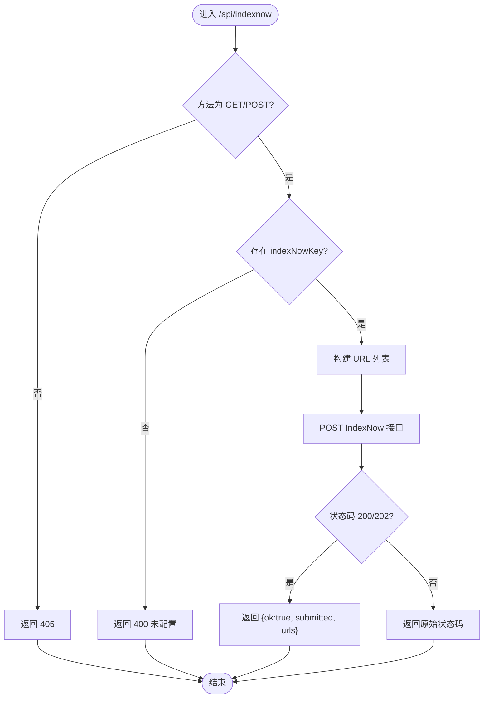
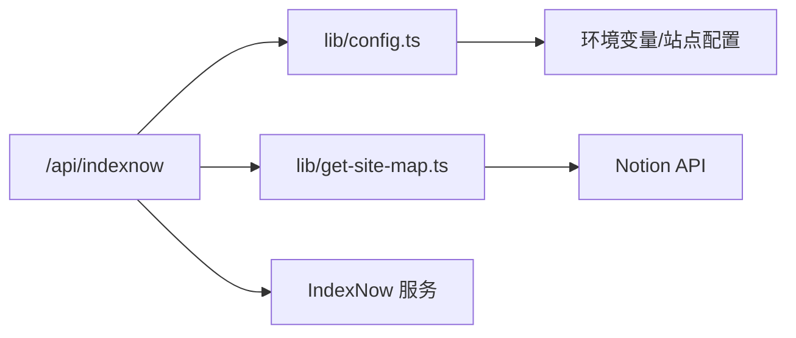

# 部署配置

<cite>
**本文引用的文件**   
- [vercel.json](file://vercel.json)
- [next.config.js](file://next.config.js)
- [pages/api/indexnow.ts](file://pages/api/indexnow.ts)
- [site.config.ts](file://site.config.ts)
- [lib/config.ts](file://lib/config.ts)
- [lib/get-site-map.ts](file://lib/get-site-map.ts)
- [.github/workflows/build.yml](file://.github/workflows/build.yml)
</cite>

## 目录
1. [简介](#简介)
2. [项目结构](#项目结构)
3. [核心组件](#核心组件)
4. [架构总览](#架构总览)
5. [详细组件分析](#详细组件分析)
6. [依赖关系分析](#依赖关系分析)
7. [性能与优化](#性能与优化)
8. [故障排查指南](#故障排查指南)
9. [结论](#结论)
10. [附录：环境变量与密钥清单](#附录环境变量与密钥清单)

## 简介
本文件面向在 Vercel 平台部署 Next.js + Notion 博客站点的项目，聚焦以下目标：
- 解释 vercel.json 的部署配置项（定时任务、路由等）
- 说明 IndexNow API 的部署与搜索引擎索引优化
- 对比不同部署环境的差异与最佳实践
- 提供自动化构建/测试流程与监控建议
- 给出常见部署问题的排查与解决方案

## 项目结构
本项目采用 Next.js App Router 风格（Pages Router），关键部署相关目录与文件如下：
- 根级部署配置：vercel.json
- Next.js 运行时配置：next.config.js
- API 路由：pages/api/*（IndexNow、搜索、社交图片等）
- 站点配置：site.config.ts 与 lib/config.ts（集中暴露站点元数据与环境变量）
- 站点地图生成：lib/get-site-map.ts（为 IndexNow 提供 URL 列表）
- CI 流水线：.github/workflows/build.yml（Node 多版本测试）

图表来源
- [vercel.json:1-10](file://vercel.json#L1-L10)
- [pages/api/indexnow.ts:1-71](file://pages/api/indexnow.ts#L1-L71)
- [lib/get-site-map.ts:1-107](file://lib/get-site-map.ts#L1-L107)
- [next.config.js:1-43](file://next.config.js#L1-L43)

章节来源
- [vercel.json:1-10](file://vercel.json#L1-L10)
- [next.config.js:1-43](file://next.config.js#L1-L43)
- [pages/api/indexnow.ts:1-71](file://pages/api/indexnow.ts#L1-L71)
- [lib/get-site-map.ts:1-107](file://lib/get-site-map.ts#L1-L107)

## 核心组件
- Vercel 部署配置（vercel.json）
  - 定义了一个定时任务（Cron），每天凌晨 3 点触发 /api/indexnow，用于向搜索引擎提交站点 URL。
- IndexNow API（pages/api/indexnow.ts）
  - 接收 GET/POST 请求，校验 IndexNow Key，从站点地图中收集 URL，调用 IndexNow 官方接口进行即时索引。
- 站点配置（site.config.ts 与 lib/config.ts）
  - site.config.ts 声明站点基础信息、SEO 验证、IndexNow Key、分析工具 ID、ISR 重验证间隔等。
  - lib/config.ts 将站点配置与环境变量合并，导出 host、domain、indexNowKey、analytics 等运行期常量。
- 站点地图（lib/get-site-map.ts）
  - 通过 Notion API 拉取页面并生成 canonicalPageMap，作为 IndexNow 提交的 URL 列表来源。
- Next.js 运行时（next.config.js）
  - 配置远程图片白名单、图片格式、CSP、包转译等，影响构建产物与运行时行为。
- CI 流水线（.github/workflows/build.yml）
  - 使用 pnpm 安装依赖并在多个 Node 版本上执行测试，确保代码质量。

章节来源
- [vercel.json:1-10](file://vercel.json#L1-L10)
- [pages/api/indexnow.ts:1-71](file://pages/api/indexnow.ts#L1-L71)
- [site.config.ts:1-78](file://site.config.ts#L1-L78)
- [lib/config.ts:1-224](file://lib/config.ts#L1-L224)
- [lib/get-site-map.ts:1-107](file://lib/get-site-map.ts#L1-L107)
- [next.config.js:1-43](file://next.config.js#L1-L43)
- [.github/workflows/build.yml:1-35](file://.github/workflows/build.yml#L1-L35)

## 架构总览
下图展示 Vercel 上的部署与 IndexNow 索引提交流程：

图表来源
- [vercel.json:1-10](file://vercel.json#L1-L10)
- [pages/api/indexnow.ts:1-71](file://pages/api/indexnow.ts#L1-L71)
- [lib/get-site-map.ts:1-107](file://lib/get-site-map.ts#L1-L107)

## 详细组件分析

### Vercel 部署配置（vercel.json）
- 定时任务（crons）
  - path: "/api/indexnow"
  - schedule: "0 3 * * *"（每日 03:00 UTC）
- 作用
  - 自动触发 IndexNow 提交，减少搜索引擎抓取延迟。
- 扩展建议
  - 如需更多路由规则或重写，可在该文件中继续添加 routes 字段（当前仓库未使用）。

章节来源
- [vercel.json:1-10](file://vercel.json#L1-L10)

### IndexNow API（pages/api/indexnow.ts）
- 功能要点
  - 仅允许 GET/POST；否则返回 405。
  - 若未配置 indexNowKey，返回 400 错误提示。
  - 调用 getSiteMap() 获取 canonicalPageMap，构造 host 下的 URL 列表。
  - 向 https://api.indexnow.org/indexnow 发送 JSON payload（host、key、keyLocation、urlList）。
  - 成功状态码为 200 或 202；响应体为空，但 API 会返回包含提交数量的结果。
  - 设置 Cache-Control: no-store，避免缓存干扰。
- 错误处理
  - 捕获异常并返回 500，附带错误消息。
- 依赖
  - 从 lib/config 读取 domain、host、indexNowKey。
  - 从 lib/get-site-map 获取站点地图。

图表来源
- [pages/api/indexnow.ts:1-71](file://pages/api/indexnow.ts#L1-L71)

章节来源
- [pages/api/indexnow.ts:1-71](file://pages/api/indexnow.ts#L1-L71)

### 站点配置与环境变量（site.config.ts 与 lib/config.ts）
- site.config.ts
  - 站点基础信息：name、domain、author、description
  - SEO 验证：bingSiteVerification、googleSiteVerification
  - IndexNow key：indexNowKey（需与 public/<key>.txt 匹配）
  - 分析工具：googleAnalyticsId、clarityId、isVercelAnalyticsEnabled、isVercelSpeedInsightsEnabled
  - ISR 重验证间隔：revalidateSeconds（默认 3600，示例设为 86400）
- lib/config.ts
  - 合并站点配置与环境变量，导出运行期常量：
    - host、domain、apiHost、apiBaseUrl
    - googleSiteVerification、bingSiteVerification、indexNowKey
    - googleAnalyticsId、isVercelAnalyticsEnabled、isVercelSpeedInsightsEnabled
  - 开发/生产环境区分：
    - isDev 基于 NODE_ENV
    - host 在开发时为本地地址，生产为 https://{domain}
    - apiHost 优先使用 VERCEL_URL（Vercel 运行时环境变量）

章节来源
- [site.config.ts:1-78](file://site.config.ts#L1-L78)
- [lib/config.ts:1-224](file://lib/config.ts#L1-L224)

### 站点地图生成（lib/get-site-map.ts）
- 功能要点
  - 通过 notion-utils 获取空间内所有页面，过滤“Public”属性为 false 的页面。
  - 计算 canonicalPageId 并去重，得到 canonicalPageMap。
  - 使用 ExpiryMap 缓存 5 分钟，降低频繁访问 Notion API 的压力。
- 对 IndexNow 的影响
  - 生成的 canonicalPageMap 被转换为 URL 列表，供 IndexNow 提交。

章节来源
- [lib/get-site-map.ts:1-107](file://lib/get-site-map.ts#L1-L107)

### Next.js 运行时配置（next.config.js）
- 图片优化
  - remotePatterns 允许 Notion CDN、Unsplash、Twitter 等域名，以及任意 https 主机以兼容外部图片。
  - formats 启用 AVIF/WebP，dangerouslyAllowSVG 开启 SVG。
  - contentSecurityPolicy 限制脚本执行，提升安全性。
- 构建与转译
  - staticPageGenerationTimeout 设置为 300 秒。
  - transpilePackages 包含 react-tweet，解决第三方包的兼容性。

章节来源
- [next.config.js:1-43](file://next.config.js#L1-L43)

### CI 流水线（.github/workflows/build.yml）
- 触发条件：push
- 矩阵策略：Node 20/22/24
- 步骤：checkout → pnpm setup → node setup → install → test
- 可扩展：可启用 build 步骤并配置 Redis 缓存（需要仓库 Secrets）

章节来源
- [.github/workflows/build.yml:1-35](file://.github/workflows/build.yml#L1-L35)

## 依赖关系分析
- 模块耦合
  - pages/api/indexnow.ts 依赖 lib/config.ts 与 lib/get-site-map.ts。
  - lib/get-site-map.ts 依赖 notion-api 与 notion-utils。
  - lib/config.ts 聚合 site.config.ts 与 process.env。
- 外部集成
  - Notion API（页面与属性）
  - IndexNow 服务（https://api.indexnow.org/indexnow）
  - Vercel Cron（定时触发）
  - 搜索引擎（Bing/Yandex）

图表来源
- [pages/api/indexnow.ts:1-71](file://pages/api/indexnow.ts#L1-L71)
- [lib/config.ts:1-224](file://lib/config.ts#L1-L224)
- [lib/get-site-map.ts:1-107](file://lib/get-site-map.ts#L1-L107)

## 性能与优化
- ISR 重验证间隔
  - 通过 revalidateSeconds 控制页面再生频率，减少函数调用次数与 Notion API 压力。
- 站点地图缓存
  - getSiteMap 使用 5 分钟过期缓存，避免频繁拉取 Notion 数据。
- 图片优化
  - 启用 AVIF/WebP 与 CSP，提升加载速度与安全性。
- 外部请求
  - IndexNow 提交仅在 Cron 触发时批量进行，避免每次请求都发起外部调用。

[本节为通用指导，不直接分析具体文件]

## 故障排查指南
- 405 方法不允许
  - 现象：调用 /api/indexnow 非 GET/POST 时报错。
  - 原因：接口仅支持 GET/POST。
  - 解决：使用 GET 或 POST 调用。
- 400 未配置 IndexNow Key
  - 现象：返回错误提示未配置 indexNowKey。
  - 原因：site.config.ts 或环境变量 INDEXNOW_KEY 缺失。
  - 解决：在 site.config.ts 中设置 indexNowKey，并确保 public/<key>.txt 存在。
- 500 内部错误
  - 现象：IndexNow 提交失败，返回错误消息。
  - 原因：网络异常、Notion API 超时、payload 构造错误等。
  - 解决：检查日志、确认 Notion Token 与权限、验证 IndexNow Key 有效性。
- 搜索引擎未收录
  - 现象：新页面未被 Bing/Yandex 快速收录。
  - 原因：IndexNow Key 未正确放置或未触发 Cron。
  - 解决：确认 public/<key>.txt 存在且可访问；检查 Vercel Cron 是否按预期执行；手动触发 /api/indexnow 验证。
- 图片无法加载
  - 现象：外部图片显示失败。
  - 原因：remotePatterns 未包含对应域名。
  - 解决：在 next.config.js 中添加对应 remotePatterns。

章节来源
- [pages/api/indexnow.ts:1-71](file://pages/api/indexnow.ts#L1-L71)
- [site.config.ts:1-78](file://site.config.ts#L1-L78)
- [lib/config.ts:1-224](file://lib/config.ts#L1-L224)
- [next.config.js:1-43](file://next.config.js#L1-L43)

## 结论
- 通过 vercel.json 的 Cron 与 pages/api/indexnow.ts 的配合，可实现对新/更新页面的即时索引提交。
- 站点配置与环境变量集中在 site.config.ts 与 lib/config.ts，便于多环境管理与安全管控。
- 合理设置 ISR 重验证间隔与站点地图缓存，可降低外部 API 调用与函数成本。
- 建议在 Vercel 环境中配置必要的 Secret（如 Notion Token、IndexNow Key），并通过 GitHub Actions 进行多版本测试保障质量。

[本节为总结性内容，不直接分析具体文件]

## 附录：环境变量与密钥清单
- 必需
  - INDEXNOW_KEY：IndexNow 密钥（可与 site.config.ts 中的 indexNowKey 一致）
  - Notion Token（由上层集成提供，未在本文列出）
- 可选
  - GOOGLE_SITE_VERIFICATION：Google Search Console 验证
  - BING_SITE_VERIFICATION：Bing Webmaster Tools 验证
  - NEXT_PUBLIC_GOOGLE_ANALYTICS_ID：GA4 测量 ID
  - VERCEL_URL：Vercel 运行时域名（用于 apiHost）
  - REDIS_HOST/REDIS_PASSWORD：Redis 缓存（CI 中预留）

章节来源
- [lib/config.ts:1-224](file://lib/config.ts#L1-L224)
- [site.config.ts:1-78](file://site.config.ts#L1-L78)
- [.github/workflows/build.yml:1-35](file://.github/workflows/build.yml#L1-L35)