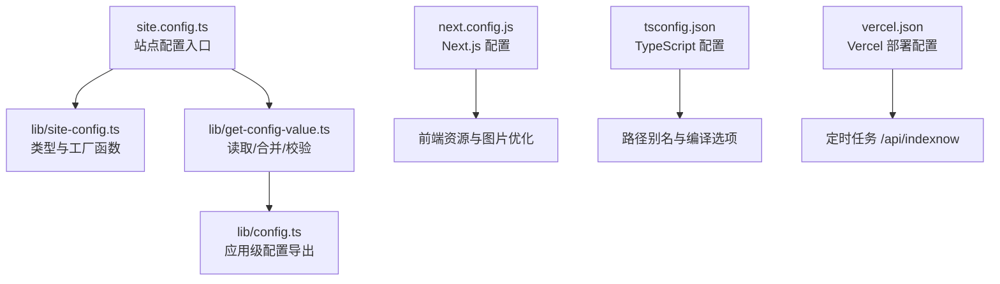
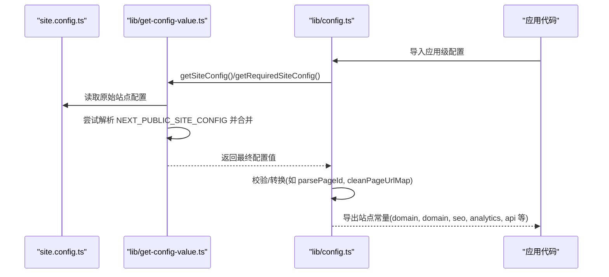
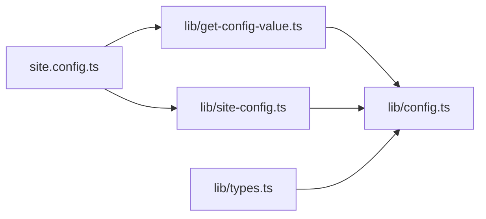

# 配置管理

<cite>
**本文引用的文件**   
- [site.config.ts](file://site.config.ts)
- [lib/site-config.ts](file://lib/site-config.ts)
- [lib/get-config-value.ts](file://lib/get-config-value.ts)
- [lib/config.ts](file://lib/config.ts)
- [lib/types.ts](file://lib/types.ts)
- [next.config.js](file://next.config.js)
- [tsconfig.json](file://tsconfig.json)
- [vercel.json](file://vercel.json)
</cite>

## 目录
1. [简介](#简介)
2. [项目结构](#项目结构)
3. [核心组件](#核心组件)
4. [架构总览](#架构总览)
5. [详细组件分析](#详细组件分析)
6. [依赖关系分析](#依赖关系分析)
7. [性能与部署考量](#性能与部署考量)
8. [故障排查指南](#故障排查指南)
9. [结论](#结论)
10. [附录：环境变量清单与最佳实践](#附录环境变量清单与最佳实践)

## 简介
本文件面向使用 Next.js + Notion 的站点，系统化说明项目的配置体系与扩展方式。重点覆盖：
- 站点级配置 site.config.ts 的所有选项（根页面、站点标识、SEO、分析工具、导航等）
- 环境变量与“环境覆盖”机制（NEXT_PUBLIC_SITE_CONFIG）
- Next.js、TypeScript、Vercel 相关配置
- 配置校验与错误处理
- 常见场景与最佳实践

## 项目结构
本项目采用“站点配置集中化 + 运行时解析”的方式组织配置：
- 站点定义位于根目录 site.config.ts
- 类型与工厂函数位于 lib/site-config.ts
- 配置读取、合并与校验逻辑位于 lib/get-config-value.ts 与 lib/config.ts
- 框架与部署相关配置分别位于 next.config.js、tsconfig.json、vercel.json

图表来源
- [site.config.ts:1-78](file://site.config.ts#L1-L78)
- [lib/site-config.ts:1-56](file://lib/site-config.ts#L1-L56)
- [lib/get-config-value.ts:1-73](file://lib/get-config-value.ts#L1-L73)
- [lib/config.ts:1-224](file://lib/config.ts#L1-L224)
- [next.config.js:1-43](file://next.config.js#L1-L43)
- [tsconfig.json:1-13](file://tsconfig.json#L1-L13)
- [vercel.json:1-10](file://vercel.json#L1-L10)

章节来源
- [site.config.ts:1-78](file://site.config.ts#L1-L78)
- [lib/site-config.ts:1-56](file://lib/site-config.ts#L1-L56)
- [lib/get-config-value.ts:1-73](file://lib/get-config-value.ts#L1-L73)
- [lib/config.ts:1-224](file://lib/config.ts#L1-L224)
- [next.config.js:1-43](file://next.config.js#L1-L43)
- [tsconfig.json:1-13](file://tsconfig.json#L1-L13)
- [vercel.json:1-10](file://vercel.json#L1-L10)

## 核心组件
- 站点配置入口 site.config.ts：声明站点名称、域名、作者、描述、Notion 根页面、SEO 验证、分析工具开关、导航样式与链接、ISR 重验证间隔等。
- 类型与工厂 lib/site-config.ts：定义 SiteConfig 接口、NavigationLink 类型以及 siteConfig 工厂函数（当前为透传）。
- 配置读取与合并 lib/get-config-value.ts：加载 site.config.ts，支持通过 NEXT_PUBLIC_SITE_CONFIG 进行 JSON 覆盖；提供 getSiteConfig、getRequiredSiteConfig、getEnv 等工具。
- 应用级配置 lib/config.ts：将站点配置与环境变量整合，输出站点运行所需的全局常量（如 rootNotionPageId、domain、SEO 验证、分析 ID、API 基址等），并进行 URL 映射清理与校验。
- 类型定义 lib/types.ts：定义 NavigationStyle、Site、PageUrlOverridesMap 等类型。
- 框架与部署 next.config.js、tsconfig.json、vercel.json：Next.js 图片优化、TS 路径别名、Vercel 定时任务。

章节来源
- [site.config.ts:1-78](file://site.config.ts#L1-L78)
- [lib/site-config.ts:1-56](file://lib/site-config.ts#L1-L56)
- [lib/get-config-value.ts:1-73](file://lib/get-config-value.ts#L1-L73)
- [lib/config.ts:1-224](file://lib/config.ts#L1-L224)
- [lib/types.ts:1-78](file://lib/types.ts#L1-L78)
- [next.config.js:1-43](file://next.config.js#L1-L43)
- [tsconfig.json:1-13](file://tsconfig.json#L1-L13)
- [vercel.json:1-10](file://vercel.json#L1-L10)

## 架构总览
站点配置的加载与使用流程如下：

图表来源
- [lib/get-config-value.ts:1-73](file://lib/get-config-value.ts#L1-L73)
- [lib/config.ts:1-224](file://lib/config.ts#L1-L224)
- [site.config.ts:1-78](file://site.config.ts#L1-L78)

## 详细组件分析

### 站点级配置 site.config.ts
- 必填项
  - rootNotionPageId：Notion 根页面 ID（用于构建站点内容树）
  - name/domain/author：站点标识信息
- 可选项
  - description：站点描述（SEO 用）
  - defaultPageIcon/defaultPageCover/defaultPageCoverPosition：全站默认图标与封面
  - isPreviewImageSupportEnabled：是否启用 LQIP 预览图
  - SEO 验证：bingSiteVerification、googleSiteVerification、indexNowKey
  - 分析工具：googleAnalyticsId、clarityId、isVercelAnalyticsEnabled、isVercelSpeedInsightsEnabled
  - pageUrlOverrides：自定义页面 URL 映射
  - revalidateSeconds：ISR 重验证间隔（秒）
  - navigationStyle/navigationLinks：导航样式与自定义链接

章节来源
- [site.config.ts:1-78](file://site.config.ts#L1-L78)

### 类型与工厂 lib/site-config.ts
- SiteConfig：站点配置的类型契约，包含所有站点级字段（含可选字段）
- NavigationLink：导航链接对象（title、pageId/url）
- siteConfig(config)：工厂函数，当前直接返回传入的配置对象，便于未来扩展校验或转换

章节来源
- [lib/site-config.ts:1-56](file://lib/site-config.ts#L1-L56)

### 配置读取与覆盖机制 lib/get-config-value.ts
- 加载 site.config.ts 并校验其存在性
- 支持通过环境变量 NEXT_PUBLIC_SITE_CONFIG 以 JSON 形式覆盖站点配置
- 提供工具函数：
  - getSiteConfig(key, defaultValue)：获取可选配置值
  - getRequiredSiteConfig(key)：获取必填配置值，缺失时抛出错误
  - getEnv(key, defaultValue)：读取环境变量，服务端缺失必填时会抛错

章节来源
- [lib/get-config-value.ts:1-73](file://lib/get-config-value.ts#L1-L73)

### 应用级配置 lib/config.ts
- 从站点配置与环境变量中聚合运行期常量：
  - 站点基础：name、author、domain、description、language
  - Notion：rootNotionPageId、rootNotionSpaceId
  - 页面 URL 映射：pageUrlOverrides/pageUrlAdditions，并进行清洗与反转
  - ISR：revalidateSeconds
  - SEO 验证：googleSiteVerification、bingSiteVerification、indexNowKey（支持 env 覆盖）
  - 分析工具：googleAnalyticsId（支持 env 覆盖）、Vercel Analytics/Speed Insights 开关、Clarity ID
  - API 地址：统一 apiBaseUrl 与若干 API 路由
  - 其他：fathomId/posthogId 等第三方分析 ID（来自环境变量）
- 关键校验：
  - rootNotionPageId 必须有效
  - pageUrlOverrides/pageUrlAdditions 中的 pageId 必须为合法 UUID，URI 必须以 "/" 开头

章节来源
- [lib/config.ts:1-224](file://lib/config.ts#L1-L224)

### 类型定义 lib/types.ts
- NavigationStyle：'default' | 'custom'
- Site：站点元数据（name、domain、rootNotionPageId、rootNotionSpaceId、description 等）
- PageUrlOverridesMap/PageUrlOverridesInverseMap：URL 与 Notion PageId 的双向映射类型

章节来源
- [lib/types.ts:1-78](file://lib/types.ts#L1-L78)

### Next.js 配置 next.config.js
- 静态生成超时：staticPageGenerationTimeout
- 图片优化 images：
  - remotePatterns：允许 Notion CDN、AWS、Twitter 等远程图片源，同时放行任意 https 主机以兼容 Notion 内嵌外部图片
  - formats：启用 AVIF/WebP
  - dangerouslyAllowSVG：允许 SVG
  - contentSecurityPolicy：限制脚本执行，增强安全
- transpilePackages：对 react-tweet 进行转译以解决兼容问题

章节来源
- [next.config.js:1-43](file://next.config.js#L1-L43)

### TypeScript 配置 tsconfig.json
- extends：继承 @fisch0920/config/tsconfig-react
- paths：配置路径别名 "@/components/*"、"@/lib/*"、"@/styles/*"
- include/exclude：包含 TS/TSX 与配置文件，排除 node_modules

章节来源
- [tsconfig.json:1-13](file://tsconfig.json#L1-L13)

### Vercel 部署配置 vercel.json
- crons：定时任务，每天凌晨 3 点调用 /api/indexnow，用于搜索引擎即时收录

章节来源
- [vercel.json:1-10](file://vercel.json#L1-L10)

## 依赖关系分析
- site.config.ts 依赖 lib/site-config.ts 的工厂函数与类型
- lib/get-config-value.ts 依赖 site.config.ts 与 lib/site-config.ts 的类型
- lib/config.ts 依赖 lib/get-config-value.ts、lib/site-config.ts 与 lib/types.ts
- 运行时由应用代码消费 lib/config.ts 导出的常量

图表来源
- [site.config.ts:1-78](file://site.config.ts#L1-L78)
- [lib/site-config.ts:1-56](file://lib/site-config.ts#L1-L56)
- [lib/get-config-value.ts:1-73](file://lib/get-config-value.ts#L1-L73)
- [lib/config.ts:1-224](file://lib/config.ts#L1-L224)
- [lib/types.ts:1-78](file://lib/types.ts#L1-L78)

## 性能与部署考量
- ISR 重验证间隔 revalidateSeconds：增大可减少 Vercel 函数调用次数，但内容更新延迟增加；建议根据更新频率权衡（例如低频站点可设为 86400）
- 图片优化：启用 AVIF/WebP 与远程白名单，减少带宽与提升首屏速度；CSP 限制脚本执行，降低安全风险
- 分析工具：按需开启 Vercel Analytics/Speed Insights，避免不必要的客户端开销
- Vercel 定时任务：IndexNow 提交有利于搜索引擎快速收录新页面

章节来源
- [lib/config.ts:93-98](file://lib/config.ts#L93-L98)
- [next.config.js:6-25](file://next.config.js#L6-L25)
- [vercel.json:1-10](file://vercel.json#L1-L10)

## 故障排查指南
- 站点配置缺失或无效
  - 现象：启动时报错提示缺少必填站点配置或无效的 site.config.ts
  - 定位：检查 site.config.ts 是否存在且导出正确；确认 rootNotionPageId 已设置
  - 参考
    - [lib/get-config-value.ts:4-6](file://lib/get-config-value.ts#L4-L6)
    - [lib/config.ts:23-30](file://lib/config.ts#L23-L30)
- 环境变量缺失
  - 现象：服务端运行时报错提示缺少必需的环境变量
  - 定位：检查 getEnv 的使用位置，确保在服务器端设置了相应环境变量
  - 参考
    - [lib/get-config-value.ts:52-72](file://lib/get-config-value.ts#L52-L72)
- 页面 URL 映射非法
  - 现象：启动时报错提示 pageUrlOverrides/pageUrlAdditions 中的 pageId 不合法或 URI 不以 "/" 开头
  - 定位：检查映射配置是否符合规范
  - 参考
    - [lib/config.ts:177-210](file://lib/config.ts#L177-L210)
- NEXT_PUBLIC_SITE_CONFIG 覆盖失败
  - 现象：控制台报错提示无法解析 JSON
  - 定位：检查环境变量值是否为合法 JSON 字符串
  - 参考
    - [lib/get-config-value.ts:11-20](file://lib/get-config-value.ts#L11-L20)

章节来源
- [lib/get-config-value.ts:4-20](file://lib/get-config-value.ts#L4-L20)
- [lib/get-config-value.ts:52-72](file://lib/get-config-value.ts#L52-L72)
- [lib/config.ts:23-30](file://lib/config.ts#L23-L30)
- [lib/config.ts:177-210](file://lib/config.ts#L177-L210)

## 结论
本项目通过集中化的站点配置与严格的环境变量覆盖机制，实现了灵活的站点定制与安全的运行期配置。配合 Next.js 的图片优化与 Vercel 的定时任务，可在保证性能与安全的同时，满足 SEO 与收录需求。建议在开发阶段充分利用 NEXT_PUBLIC_SITE_CONFIG 进行快速迭代，在生产环境通过环境变量注入敏感配置，并遵循本文的最佳实践与校验规则。

## 附录：环境变量清单与最佳实践

### 环境变量清单
- NEXT_PUBLIC_SITE_CONFIG：JSON 字符串，用于覆盖站点配置（优先级高于 site.config.ts）
- NEXT_PUBLIC_GOOGLE_ANALYTICS_ID：Google Analytics 4 测量 ID（可通过站点配置或环境变量设置）
- NEXT_PUBLIC_FATHOM_ID：Fathom 分析 ID（仅生产环境生效）
- NEXT_PUBLIC_POSTHOG_ID：PostHog 分析 ID
- GOOGLE_SITE_VERIFICATION：Google Search Console 验证码（可覆盖站点配置）
- BING_SITE_VERIFICATION：Bing Webmaster Tools 验证码（可覆盖站点配置）
- INDEXNOW_KEY：IndexNow 密钥（可覆盖站点配置）
- VERCEL_URL：Vercel 部署时的域名（用于构建 API 基址）
- NODE_ENV：运行环境（development/production）
- PORT：本地开发端口

章节来源
- [lib/get-config-value.ts:11-20](file://lib/get-config-value.ts#L11-L20)
- [lib/config.ts:117-146](file://lib/config.ts#L117-L146)
- [lib/config.ts:165-175](file://lib/config.ts#L165-L175)

### 最佳实践
- 将敏感信息（分析 ID、SEO 验证码、IndexNow 密钥）放入环境变量，避免硬编码到仓库
- 使用 NEXT_PUBLIC_SITE_CONFIG 仅在需要覆盖少量字段时使用，保持 site.config.ts 作为单一事实来源
- 合理设置 revalidateSeconds，平衡内容新鲜度与部署成本
- 谨慎配置 pageUrlOverrides/pageUrlAdditions，确保 URI 以 "/" 开头且 pageId 为合法 UUID
- 在生产环境关闭调试类功能（如包含 Notion ID 的 URL），以减少信息泄露风险

章节来源
- [lib/config.ts:74-78](file://lib/config.ts#L74-L78)
- [lib/config.ts:93-98](file://lib/config.ts#L93-L98)
- [lib/config.ts:177-210](file://lib/config.ts#L177-L210)