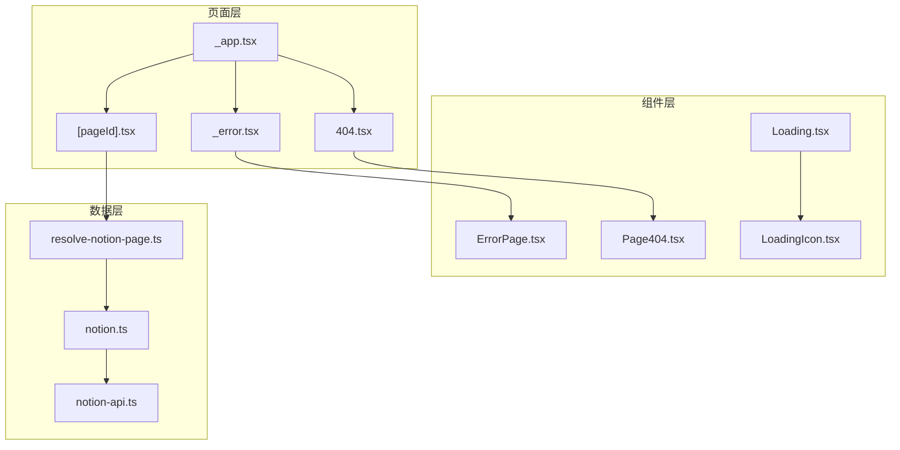
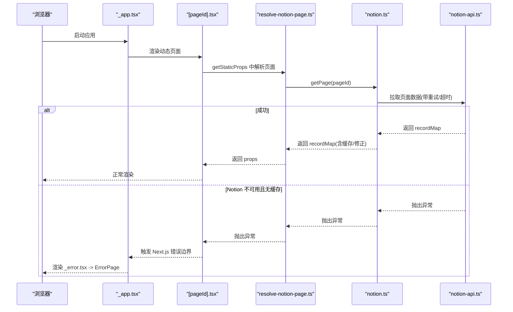
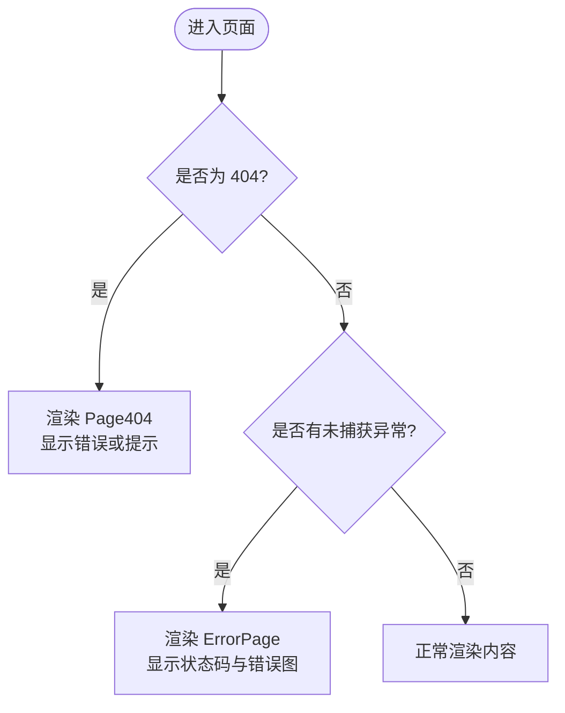
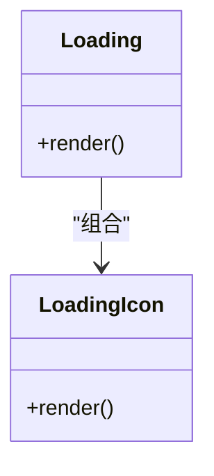
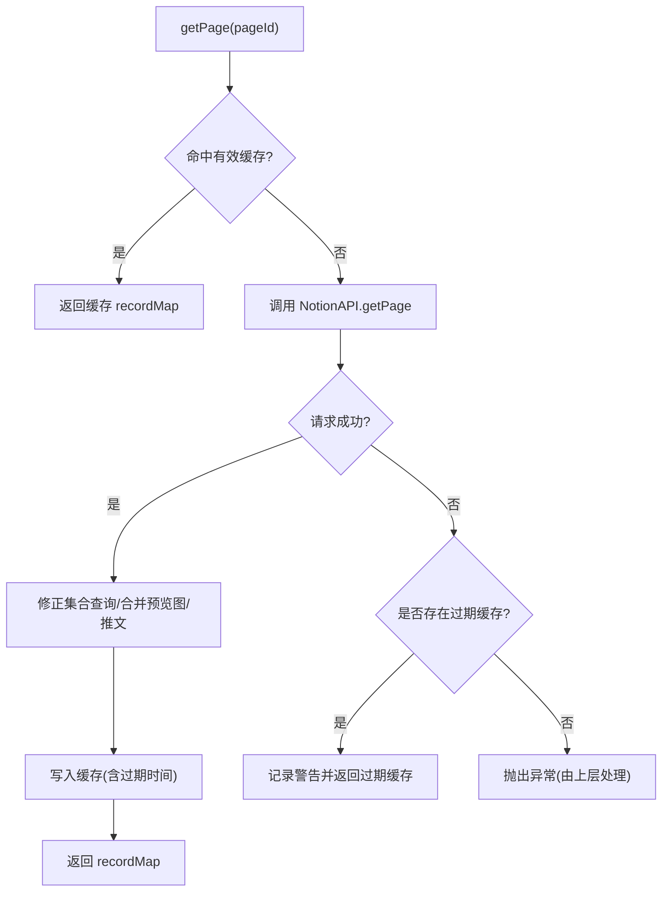
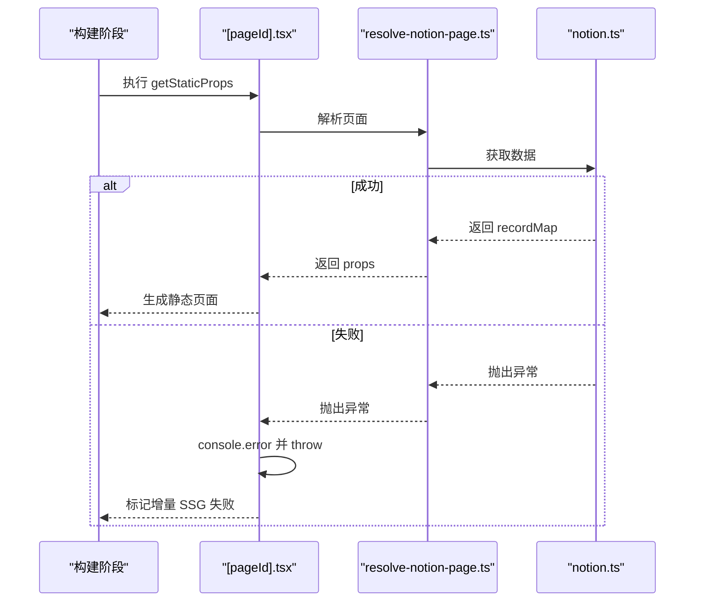

# 错误处理与用户体验

<cite>
**本文引用的文件**   
- [components/ErrorPage.tsx](file://components/ErrorPage.tsx)
- [components/Page404.tsx](file://components/Page404.tsx)
- [components/Loading.tsx](file://components/Loading.tsx)
- [components/LoadingIcon.tsx](file://components/LoadingIcon.tsx)
- [pages/_error.tsx](file://pages/_error.tsx)
- [pages/404.tsx](file://pages/404.tsx)
- [lib/notion-api.ts](file://lib/notion-api.ts)
- [lib/notion.ts](file://lib/notion.ts)
- [lib/resolve-notion-page.ts](file://lib/resolve-notion-page.ts)
- [pages/[pageId].tsx](file://pages/[pageId].tsx)
- [pages/_app.tsx](file://pages/_app.tsx)
</cite>

## 目录
1. [简介](#简介)
2. [项目结构](#项目结构)
3. [核心组件](#核心组件)
4. [架构总览](#架构总览)
5. [详细组件分析](#详细组件分析)
6. [依赖关系分析](#依赖关系分析)
7. [性能与可用性考虑](#性能与可用性考虑)
8. [故障诊断与调试指南](#故障诊断与调试指南)
9. [结论](#结论)

## 简介
本文件聚焦于项目的错误处理机制与用户体验设计，覆盖以下方面：
- 错误页面设计与展示（通用错误、404）
- 加载状态管理（全局加载指示器）
- 用户反馈机制（错误信息呈现、可访问性）
- 异常捕获与降级策略（缓存回退、重试、超时）
- 错误日志记录与分析埋点
- 无障碍访问与国际化支持建议
- 错误诊断工具与调试方法

## 项目结构
本项目采用 Next.js 应用结构，错误处理与用户体验相关的关键位置如下：
- 页面级错误入口：pages/_error.tsx、pages/404.tsx
- 错误与 404 视图组件：components/ErrorPage.tsx、components/Page404.tsx
- 加载状态组件：components/Loading.tsx、components/LoadingIcon.tsx
- Notion 数据获取与容错：lib/notion-api.ts、lib/notion.ts
- 路由解析与 404 判定：lib/resolve-notion-page.ts
- 动态页面构建与 SSG 错误处理：pages/[pageId].tsx
- 应用初始化与埋点：pages/_app.tsx



图表来源
- [pages/_app.tsx:1-91](file://pages/_app.tsx#L1-L91)
- [pages/404.tsx:1-2](file://pages/404.tsx#L1-L2)
- [pages/_error.tsx:1-2](file://pages/_error.tsx#L1-L2)
- [components/ErrorPage.tsx:1-23](file://components/ErrorPage.tsx#L1-L23)
- [components/Page404.tsx:1-38](file://components/Page404.tsx#L1-L38)
- [components/Loading.tsx:1-11](file://components/Loading.tsx#L1-L11)
- [components/LoadingIcon.tsx:1-62](file://components/LoadingIcon.tsx#L1-L62)
- [lib/notion-api.ts:1-20](file://lib/notion-api.ts#L1-L20)
- [lib/notion.ts:1-219](file://lib/notion.ts#L1-L219)
- [lib/resolve-notion-page.ts:1-85](file://lib/resolve-notion-page.ts#L1-L85)
- [pages/[pageId].tsx:1-36](file://pages/[pageId].tsx#L1-L36)

章节来源
- [pages/_app.tsx:1-91](file://pages/_app.tsx#L1-L91)
- [pages/404.tsx:1-2](file://pages/404.tsx#L1-L2)
- [pages/_error.tsx:1-2](file://pages/_error.tsx#L1-L2)
- [components/ErrorPage.tsx:1-23](file://components/ErrorPage.tsx#L1-L23)
- [components/Page404.tsx:1-38](file://components/Page404.tsx#L1-L38)
- [components/Loading.tsx:1-11](file://components/Loading.tsx#L1-L11)
- [components/LoadingIcon.tsx:1-62](file://components/LoadingIcon.tsx#L1-L62)
- [lib/notion-api.ts:1-20](file://lib/notion-api.ts#L1-L20)
- [lib/notion.ts:1-219](file://lib/notion.ts#L1-L219)
- [lib/resolve-notion-page.ts:1-85](file://lib/resolve-notion-page.ts#L1-L85)
- [pages/[pageId].tsx:1-36](file://pages/[pageId].tsx#L1-L36)

## 核心组件
- 通用错误页 ErrorPage：渲染统一错误标题、可选的状态码提示与错误图片。
- 404 页面 Page404：根据是否携带错误对象或 pageId 显示不同文案，并提供 404 插图。
- Loading 与 LoadingIcon：提供轻量级的加载动画，用于数据请求期间的用户反馈。
- Notion API 客户端 notion-api：封装重试、超时、User-Agent 等网络参数，提升稳定性。
- Notion 数据层 notion：实现内存缓存、过期回退、集合查询修正、预览图与推文合并等逻辑。
- 路由解析 resolve-notion-page：负责 URI 到 Notion pageId 的映射、站点地图查找、404 判定与 ACL 校验。
- 动态页面 [pageId].tsx：SSG 构建时调用解析函数并处理构建期错误。
- 应用入口 _app.tsx：初始化分析工具、埋点与全局脚本。

章节来源
- [components/ErrorPage.tsx:1-23](file://components/ErrorPage.tsx#L1-L23)
- [components/Page404.tsx:1-38](file://components/Page404.tsx#L1-L38)
- [components/Loading.tsx:1-11](file://components/Loading.tsx#L1-L11)
- [components/LoadingIcon.tsx:1-62](file://components/LoadingIcon.tsx#L1-L62)
- [lib/notion-api.ts:1-20](file://lib/notion-api.ts#L1-L20)
- [lib/notion.ts:1-219](file://lib/notion.ts#L1-L219)
- [lib/resolve-notion-page.ts:1-85](file://lib/resolve-notion-page.ts#L1-L85)
- [pages/[pageId].tsx:1-36](file://pages/[pageId].tsx#L1-L36)
- [pages/_app.tsx:1-91](file://pages/_app.tsx#L1-L91)

## 架构总览
下图展示了从页面渲染到数据获取的错误处理与降级路径：



图表来源
- [pages/_app.tsx:1-91](file://pages/_app.tsx#L1-L91)
- [pages/[pageId].tsx:1-36](file://pages/[pageId].tsx#L1-L36)
- [lib/resolve-notion-page.ts:1-85](file://lib/resolve-notion-page.ts#L1-L85)
- [lib/notion.ts:1-219](file://lib/notion.ts#L1-L219)
- [lib/notion-api.ts:1-20](file://lib/notion-api.ts#L1-L20)

## 详细组件分析

### 错误页面与 404 页面
- 通用错误页 ErrorPage：接收 statusCode，输出“Error Loading Page”标题、可选错误码段落与错误图片。
- 404 页面 Page404：当存在 error 对象时显示其 message；否则若存在 pageId，提示该 Notion 页面需公开可见；始终展示 404 插图。
- 页面路由：
  - pages/_error.tsx 将默认导出指向 components/ErrorPage.tsx。
  - pages/404.tsx 将默认导出指向 components/Page404.tsx。



图表来源
- [components/Page404.tsx:1-38](file://components/Page404.tsx#L1-L38)
- [components/ErrorPage.tsx:1-23](file://components/ErrorPage.tsx#L1-L23)
- [pages/404.tsx:1-2](file://pages/404.tsx#L1-L2)
- [pages/_error.tsx:1-2](file://pages/_error.tsx#L1-L2)

章节来源
- [components/Page404.tsx:1-38](file://components/Page404.tsx#L1-L38)
- [components/ErrorPage.tsx:1-23](file://components/ErrorPage.tsx#L1-L23)
- [pages/404.tsx:1-2](file://pages/404.tsx#L1-L2)
- [pages/_error.tsx:1-2](file://pages/_error.tsx#L1-L2)

### 加载状态管理
- Loading 组件：居中容器内渲染 LoadingIcon，作为数据加载时的占位反馈。
- LoadingIcon 组件：使用 SVG 绘制旋转进度环，便于在任意需要等待的场景复用。



图表来源
- [components/Loading.tsx:1-11](file://components/Loading.tsx#L1-L11)
- [components/LoadingIcon.tsx:1-62](file://components/LoadingIcon.tsx#L1-L62)

章节来源
- [components/Loading.tsx:1-11](file://components/Loading.tsx#L1-L11)
- [components/LoadingIcon.tsx:1-62](file://components/LoadingIcon.tsx#L1-L62)

### Notion 数据获取与降级策略
- 网络层 notion-api：
  - 配置重试次数、重试延迟、重试状态码与超时时间，降低瞬时失败对页面的影响。
- 业务层 notion：
  - 服务器端内存缓存：按 pageId 缓存 recordMap，TTL 较短以兼顾新鲜度与容灾。
  - 过期回退：当 Notion 不可用时，优先返回可能过期的缓存数据，避免直接 5xx。
  - 集合查询修正：针对代理导致的嵌套结构问题，重新执行 collection 查询并合并结果。
  - 附加数据处理：按需合并预览图与推文数据。
- 路由层 resolve-notion-page：
  - 解析 rawPageId，尝试站点地图映射与缓存，最终调用 getPage。
  - 无法找到对应 pageId 时返回 404 错误对象。



图表来源
- [lib/notion.ts:1-219](file://lib/notion.ts#L1-L219)
- [lib/notion-api.ts:1-20](file://lib/notion-api.ts#L1-L20)

章节来源
- [lib/notion-api.ts:1-20](file://lib/notion-api.ts#L1-L20)
- [lib/notion.ts:1-219](file://lib/notion.ts#L1-L219)
- [lib/resolve-notion-page.ts:1-85](file://lib/resolve-notion-page.ts#L1-L85)

### 动态页面与 SSG 错误处理
- [pageId].tsx：
  - getStaticProps 中调用 resolveNotionPage，成功后返回 props 并设置 revalidate。
  - 捕获构建期异常，打印错误日志并向上抛出，交由 Next.js 错误边界处理。
  - getStaticPaths 在非开发环境启用 blocking 模式，确保首次访问时进行服务端渲染。



图表来源
- [pages/[pageId].tsx:1-36](file://pages/[pageId].tsx#L1-L36)
- [lib/resolve-notion-page.ts:1-85](file://lib/resolve-notion-page.ts#L1-L85)
- [lib/notion.ts:1-219](file://lib/notion.ts#L1-L219)

章节来源
- [pages/[pageId].tsx:1-36](file://pages/[pageId].tsx#L1-L36)

### 应用初始化与埋点
- _app.tsx：
  - 非服务端环境下执行 bootstrap。
  - 监听路由变化，上报 Fathom 与 PostHog 页面浏览事件。
  - 条件注入 Vercel Analytics、Speed Insights 与 Microsoft Clarity 脚本。

章节来源
- [pages/_app.tsx:1-91](file://pages/_app.tsx#L1-L91)

## 依赖关系分析
- 页面层依赖组件层：
  - _error.tsx 依赖 ErrorPage.tsx
  - 404.tsx 依赖 Page404.tsx
- 动态页面依赖解析层与数据层：
  - [pageId].tsx 依赖 resolve-notion-page.ts
  - resolve-notion-page.ts 依赖 notion.ts
  - notion.ts 依赖 notion-api.ts
- 组件内部依赖：
  - Loading.tsx 依赖 LoadingIcon.tsx

```mermaid
graph LR
ErrorPage["ErrorPage.tsx"] <|-- _error["pages/_error.tsx"]
Page404["Page404.tsx"] <|-- P404["pages/404.tsx"]
DynamicPage["pages/[pageId].tsx"] --> Resolve["lib/resolve-notion-page.ts"]
Resolve --> NotionCore["lib/notion.ts"]
NotionCore --> NotionAPI["lib/notion-api.ts"]
Loading["components/Loading.tsx"] --> LoadingIcon["components/LoadingIcon.tsx"]
```

图表来源
- [pages/_error.tsx:1-2](file://pages/_error.tsx#L1-L2)
- [components/ErrorPage.tsx:1-23](file://components/ErrorPage.tsx#L1-L23)
- [pages/404.tsx:1-2](file://pages/404.tsx#L1-L2)
- [components/Page404.tsx:1-38](file://components/Page404.tsx#L1-L38)
- [pages/[pageId].tsx:1-36](file://pages/[pageId].tsx#L1-L36)
- [lib/resolve-notion-page.ts:1-85](file://lib/resolve-notion-page.ts#L1-L85)
- [lib/notion.ts:1-219](file://lib/notion.ts#L1-L219)
- [lib/notion-api.ts:1-20](file://lib/notion-api.ts#L1-L20)
- [components/Loading.tsx:1-11](file://components/Loading.tsx#L1-L11)
- [components/LoadingIcon.tsx:1-62](file://components/LoadingIcon.tsx#L1-L62)

## 性能与可用性考虑
- 性能优化
  - 服务器端内存缓存减少重复请求，TTL 短以保证数据新鲜度。
  - 并发控制：导航链接页面与集合查询修正使用并发限制，避免资源争用。
  - 网络重试与超时：通过 ofetchOptions 自动重试瞬态错误，降低抖动影响。
- 可用性保障
  - 降级策略：Notion 不可用时返回过期缓存，避免全站 5xx。
  - 渐进增强：仅在必要时执行集合查询修正与预览图/推文合并。
- 用户体验
  - 明确的错误与 404 提示，配合插图提升可读性。
  - 加载动画提供即时反馈，缓解等待焦虑。
- 无障碍访问
  - 错误与 404 图片包含 alt 文本，便于屏幕阅读器理解。
  - 建议在后续迭代中为关键交互元素补充 aria-* 属性与键盘可达性。
- 国际化支持
  - 当前错误文案硬编码为英文。建议抽取 i18n 键值，根据语言包切换文案，保持错误提示一致性与可维护性。

[本节为通用指导，不直接分析具体文件]

## 故障诊断与调试指南
- 定位 404
  - 检查 resolve-notion-page.ts 中的 URI 到 pageId 映射逻辑与站点地图。
  - 确认 Notion 页面是否已公开分享。
- 排查 Notion 接口异常
  - 查看 notion-api.ts 的重试与超时配置是否符合预期。
  - 关注 notion.ts 中的警告日志，判断是否触发了过期缓存回退。
- 构建期错误
  - 查看 [pageId].tsx 的 getStaticProps 捕获日志，确认异常来源。
  - 在本地开发环境中开启 Next.js 的 blocking 行为，复现首次访问渲染流程。
- 分析与监控
  - 利用 _app.tsx 中集成的 Fathom、PostHog、Vercel Analytics/Speed Insights 与 Clarity，观察页面访问与性能指标。
  - 结合控制台日志与生产日志平台，聚合错误堆栈与上下文信息。

章节来源
- [lib/resolve-notion-page.ts:1-85](file://lib/resolve-notion-page.ts#L1-L85)
- [lib/notion-api.ts:1-20](file://lib/notion-api.ts#L1-L20)
- [lib/notion.ts:1-219](file://lib/notion.ts#L1-L219)
- [pages/[pageId].tsx:1-36](file://pages/[pageId].tsx#L1-L36)
- [pages/_app.tsx:1-91](file://pages/_app.tsx#L1-L91)

## 结论
该项目通过清晰的错误页面与 404 提示、统一的加载反馈、稳健的网络重试与缓存回退策略，构建了较为完善的错误处理与用户体验体系。建议在后续迭代中完善无障碍与国际化支持，并持续优化监控与诊断能力，以提升整体可用性与可维护性。