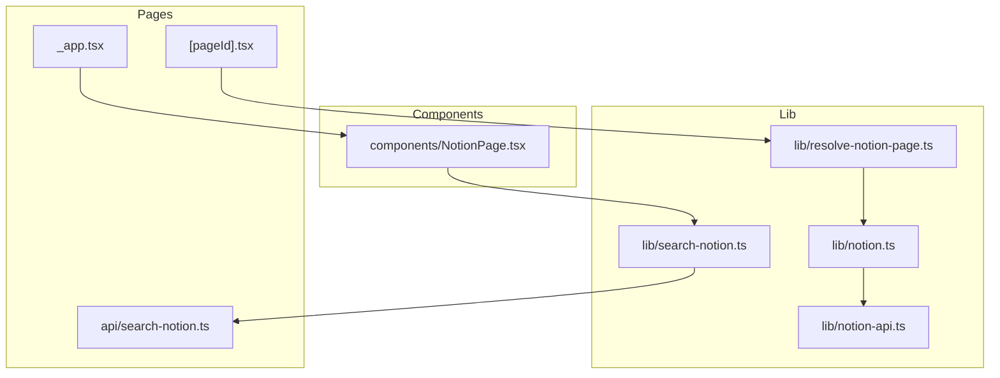
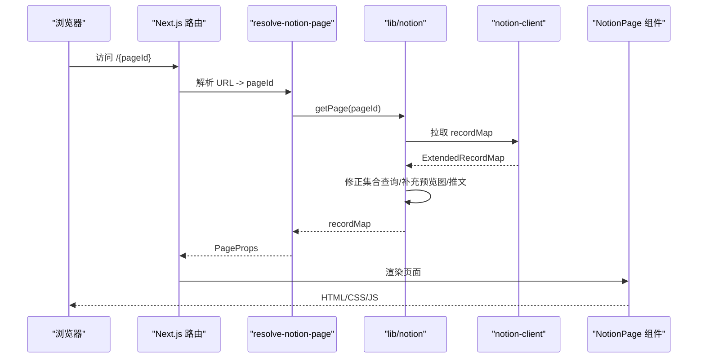
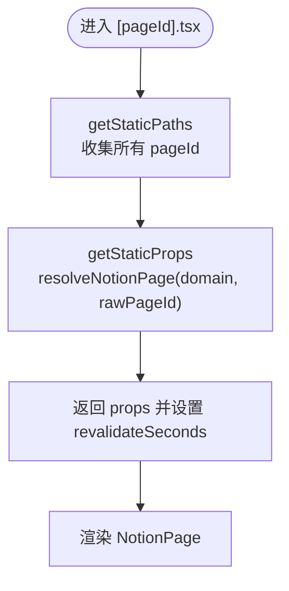
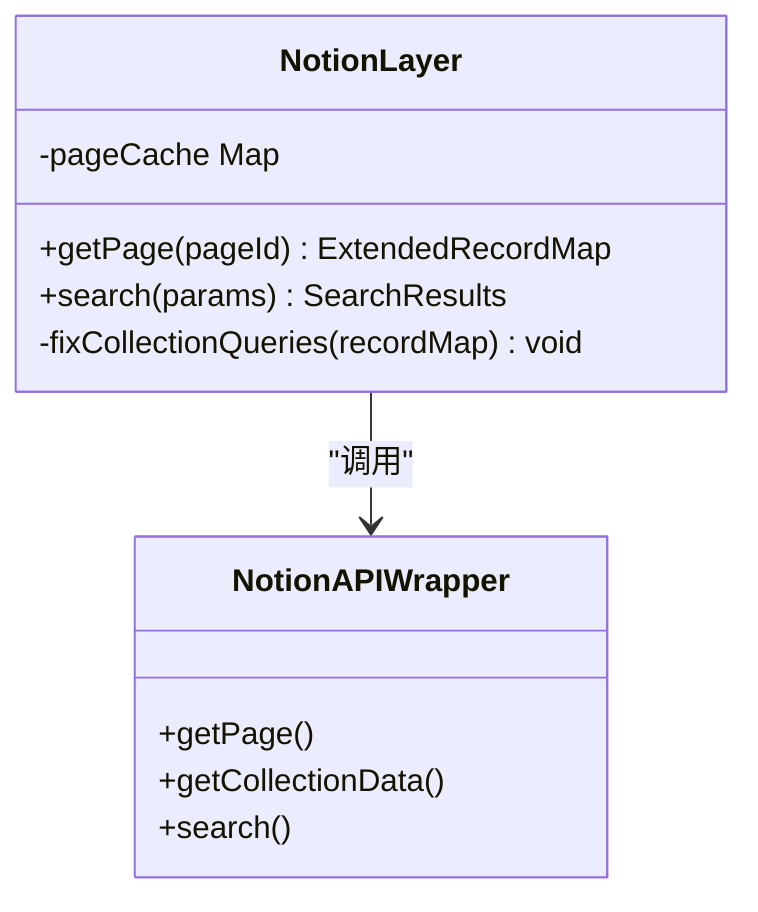
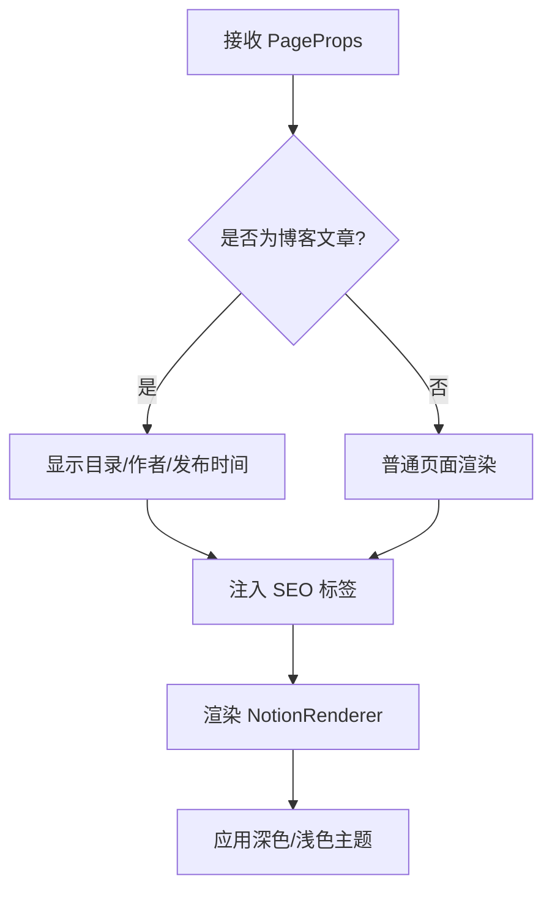
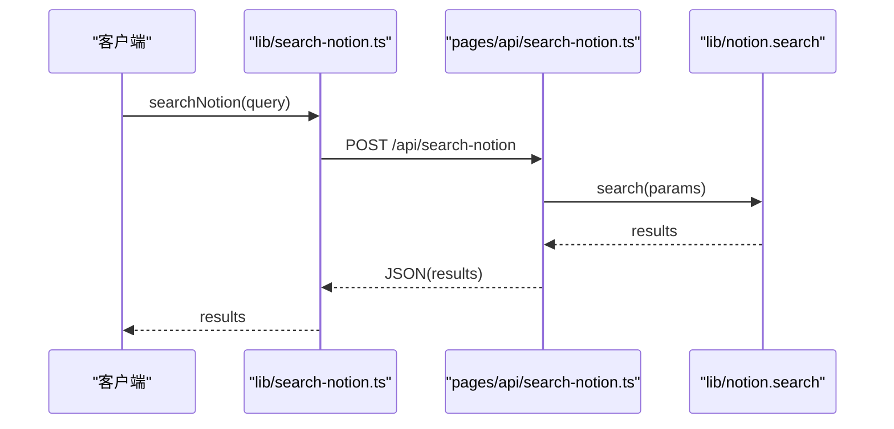
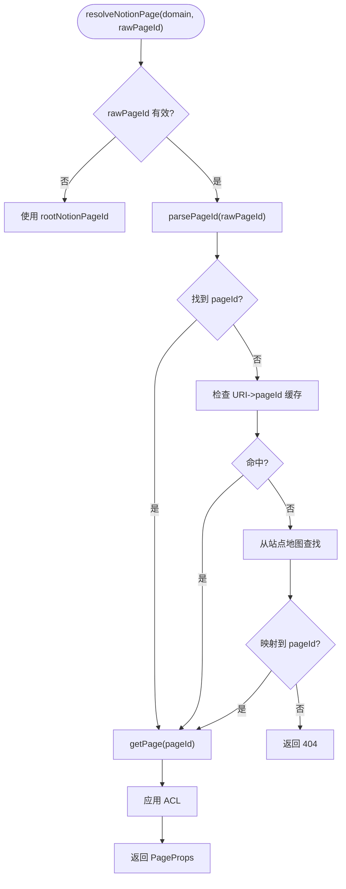
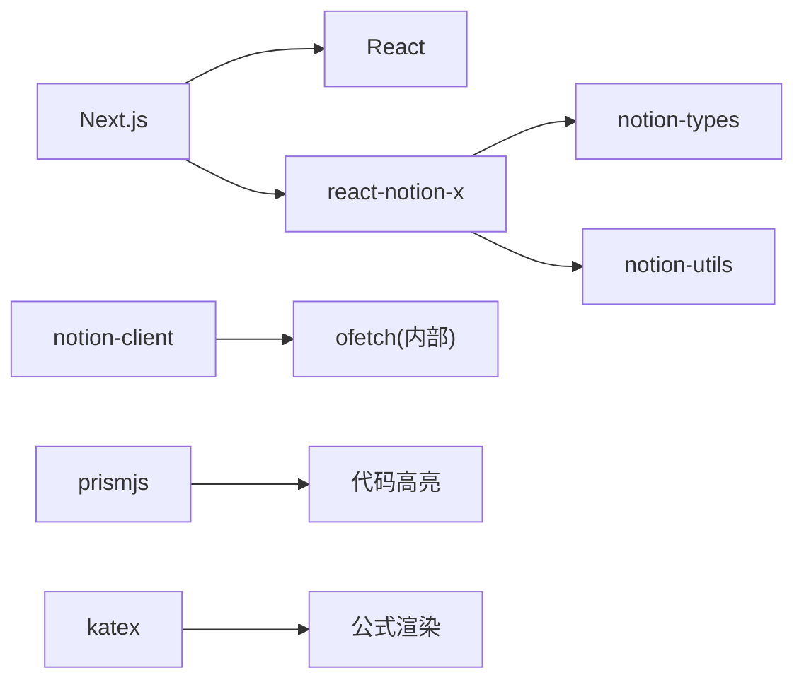

# 项目概述

<cite>
**本文引用的文件**   
- [package.json](file://package.json)
- [site.config.ts](file://site.config.ts)
- [pages/_app.tsx](file://pages/_app.tsx)
- [lib/notion.ts](file://lib/notion.ts)
- [lib/notion-api.ts](file://lib/notion-api.ts)
- [pages/[pageId].tsx](file://pages/[pageId].tsx)
- [components/NotionPage.tsx](file://components/NotionPage.tsx)
- [lib/resolve-notion-page.ts](file://lib/resolve-notion-page.ts)
- [lib/search-notion.ts](file://lib/search-notion.ts)
- [pages/api/search-notion.ts](file://pages/api/search-notion.ts)
</cite>

## 目录
1. [简介](#简介)
2. [项目结构](#项目结构)
3. [核心组件](#核心组件)
4. [架构总览](#架构总览)
5. [详细组件分析](#详细组件分析)
6. [依赖关系分析](#依赖关系分析)
7. [性能与缓存](#性能与缓存)
8. [快速开始](#快速开始)
9. [故障排查](#故障排查)
10. [结论](#结论)

## 简介
nextjs-notion-starter-kit 是一个基于 Next.js 和 Notion API 构建的现代化博客与内容管理系统启动模板。它将 Notion 页面直接转换为可搜索的网站页面，提供静态站点生成、增量静态再生（ISR）、全文搜索、SEO 优化、深色/浅色模式切换以及响应式布局等能力。技术栈包括 TypeScript、React、Next.js、react-notion-x 等，适合用于个人博客、知识库、文档站等内容驱动型网站。

主要用例：
- 将 Notion 页面映射为可索引、可搜索的网站页面
- 通过 ISR 在后台按需重建页面，兼顾性能与时效性
- 使用 react-notion-x 渲染 Notion 原生块类型（代码高亮、公式、PDF、集合视图等）
- 集成搜索引擎验证、社交分享图、RSS、站点地图等 SEO 基础设施
- 支持深色/浅色主题切换与移动端友好布局

## 项目结构
该项目采用 Next.js App Router 之外的 Pages Router 组织方式，按“页面 + 组件 + 库”分层：
- pages：路由入口、API 接口、站点元数据（sitemap、robots、feed）
- components：UI 组件（页面主体、头部、侧边栏、搜索弹窗、评论等）
- lib：业务逻辑与工具（Notion 数据获取、URL 映射、搜索、配置、类型定义等）
- styles：全局样式与 notion/prism 主题覆盖
- public：静态资源（字体、清单、IndexNow 校验文件等）

图表来源
- [pages/_app.tsx:1-91](file://pages/_app.tsx#L1-L91)
- [pages/[pageId].tsx:1-58](file://pages/[pageId].tsx#L1-L58)
- [components/NotionPage.tsx:1-356](file://components/NotionPage.tsx#L1-L356)
- [lib/resolve-notion-page.ts:1-85](file://lib/resolve-notion-page.ts#L1-L85)
- [lib/notion.ts:1-219](file://lib/notion.ts#L1-L219)
- [lib/notion-api.ts:1-21](file://lib/notion-api.ts#L1-L21)
- [lib/search-notion.ts:1-40](file://lib/search-notion.ts#L1-L40)
- [pages/api/search-notion.ts:1-26](file://pages/api/search-notion.ts#L1-L26)

章节来源
- [package.json:1-93](file://package.json#L1-L93)
- [site.config.ts:1-77](file://site.config.ts#L1-L77)

## 核心组件
- 应用壳与全局初始化：_app.tsx 负责注入全局样式、数学公式与代码高亮样式、埋点与分析脚本，并统一处理路由变化事件。
- 页面路由与 SSG/ISR：[pageId].tsx 通过 getStaticPaths 与 getStaticProps 实现静态生成与增量再生；结合 site.config.ts 中的 revalidateSeconds 控制重建频率。
- Notion 数据层：lib/notion.ts 封装了 Notion 页面获取、集合查询修正、预览图与推文解析、内存缓存与降级策略；lib/notion-api.ts 提供带重试与超时的 NotionAPI 实例。
- 页面渲染：components/NotionPage.tsx 基于 react-notion-x 渲染 Notion 内容，注入自定义组件（代码高亮、集合、公式、PDF、Modal、Tweet），并处理 SEO、深色模式、侧边栏与评论。
- URL 解析与权限：lib/resolve-notion-page.ts 将用户友好的路径映射到 Notion pageId，并结合 ACL 决定访问权限。
- 搜索：lib/search-notion.ts 作为客户端搜索入口，调用 pages/api/search-notion.ts 服务端接口，后者再调用 lib/notion.search。

章节来源
- [pages/_app.tsx:1-91](file://pages/_app.tsx#L1-L91)
- [pages/[pageId].tsx:1-58](file://pages/[pageId].tsx#L1-L58)
- [lib/notion.ts:1-219](file://lib/notion.ts#L1-L219)
- [lib/notion-api.ts:1-21](file://lib/notion-api.ts#L1-L21)
- [components/NotionPage.tsx:1-356](file://components/NotionPage.tsx#L1-L356)
- [lib/resolve-notion-page.ts:1-85](file://lib/resolve-notion-page.ts#L1-L85)
- [lib/search-notion.ts:1-40](file://lib/search-notion.ts#L1-L40)
- [pages/api/search-notion.ts:1-26](file://pages/api/search-notion.ts#L1-L26)

## 架构总览
系统由前端渲染层、Next.js 路由层、后端 API 层与 Notion 服务组成。关键流程如下：
- 构建期：根据站点地图与 URL 重写规则生成静态页面路径；运行时通过 ISR 定期或按需重建。
- 请求期：页面路由解析 URL 到 Notion pageId，拉取 recordMap，进行集合查询修正与预览图/推文补充，最终交给 NotionPage 渲染。
- 搜索：前端发起搜索请求至 /api/search-notion，服务端调用 Notion 搜索 API 并返回结果。

图表来源
- [pages/[pageId].tsx:1-58](file://pages/[pageId].tsx#L1-L58)
- [lib/resolve-notion-page.ts:1-85](file://lib/resolve-notion-page.ts#L1-L85)
- [lib/notion.ts:1-219](file://lib/notion.ts#L1-L219)
- [lib/notion-api.ts:1-21](file://lib/notion-api.ts#L1-L21)
- [components/NotionPage.tsx:1-356](file://components/NotionPage.tsx#L1-L356)

## 详细组件分析

### 页面路由与静态生成
- [pageId].tsx 使用 getStaticPaths 收集所有可构建的页面 ID（站点地图 + URL 重写），并在开发环境启用 fallback:true 以按需构建。
- getStaticProps 调用 resolveNotionPage 获取 props，并通过 revalidateSeconds 开启 ISR 增量再生。

图表来源
- [pages/[pageId].tsx:1-58](file://pages/[pageId].tsx#L1-L58)
- [lib/resolve-notion-page.ts:1-85](file://lib/resolve-notion-page.ts#L1-L85)

章节来源
- [pages/[pageId].tsx:1-58](file://pages/[pageId].tsx#L1-L58)

### Notion 数据获取与缓存
- lib/notion.ts 维护进程内内存缓存，TTL 较短以保证时效性；当 Notion 不可用时回退到过期缓存，避免 500。
- 对集合视图的排序与过滤进行二次查询修正，确保与 Notion 所见即所得。
- 可选地注入预览图与推文数据，提升首屏体验与社交分享效果。

图表来源
- [lib/notion.ts:1-219](file://lib/notion.ts#L1-L219)
- [lib/notion-api.ts:1-21](file://lib/notion-api.ts#L1-L21)

章节来源
- [lib/notion.ts:1-219](file://lib/notion.ts#L1-L219)
- [lib/notion-api.ts:1-21](file://lib/notion-api.ts#L1-L21)

### 页面渲染与主题
- components/NotionPage.tsx 基于 react-notion-x 渲染 Notion 内容，动态加载代码高亮、集合、公式、PDF、Modal 等第三方组件。
- 支持深色/浅色模式切换，通过 BodyClassName 注入主题类名。
- 针对博客文章自动展示目录、作者、发布时间、最后修改时间等元信息，并注入 SEO 标签。

图表来源
- [components/NotionPage.tsx:1-356](file://components/NotionPage.tsx#L1-L356)

章节来源
- [components/NotionPage.tsx:1-356](file://components/NotionPage.tsx#L1-L356)

### 搜索功能
- 客户端通过 lib/search-notion.ts 发起 POST 请求到 /api/search-notion，参数为搜索条件。
- 服务端 pages/api/search-notion.ts 调用 lib/notion.search 执行搜索，并设置缓存头以加速重复查询。

图表来源
- [lib/search-notion.ts:1-40](file://lib/search-notion.ts#L1-L40)
- [pages/api/search-notion.ts:1-26](file://pages/api/search-notion.ts#L1-L26)
- [lib/notion.ts:216-219](file://lib/notion.ts#L216-L219)

章节来源
- [lib/search-notion.ts:1-40](file://lib/search-notion.ts#L1-L40)
- [pages/api/search-notion.ts:1-26](file://pages/api/search-notion.ts#L1-L26)

### URL 解析与权限控制
- lib/resolve-notion-page.ts 将用户友好的路径映射到 Notion pageId，优先尝试 URI-to-pageId 缓存，其次查站点地图，最后返回 404。
- 同时结合 ACL 模块决定是否允许访问该页面。

图表来源
- [lib/resolve-notion-page.ts:1-85](file://lib/resolve-notion-page.ts#L1-L85)

章节来源
- [lib/resolve-notion-page.ts:1-85](file://lib/resolve-notion-page.ts#L1-L85)

## 依赖关系分析
- 运行时依赖：Next.js、React、react-notion-x、notion-client、prismjs、katex、rss 等。
- 开发与质量：TypeScript、ESLint、Prettier。
- 分析与性能：Vercel Analytics、Speed Insights、Fathom、PostHog、Microsoft Clarity。

图表来源
- [package.json:30-68](file://package.json#L30-L68)

章节来源
- [package.json:1-93](file://package.json#L1-L93)

## 性能与缓存
- 进程内内存缓存：lib/notion.ts 对每个 pageId 缓存 ExtendedRecordMap，TTL 短（秒级），既吸收突发流量又保证较新数据。
- 降级策略：Notion 不可用时返回过期缓存，避免全站 500。
- ISR 增量再生：通过 revalidateSeconds 控制页面重建频率，减少函数调用次数。
- 客户端搜索缓存：lib/search-notion.ts 使用 ExpiryMap 对搜索结果做短期缓存，降低重复请求。
- 图片与媒体：可选启用 LQIP 预览图，提升首屏体验。

章节来源
- [lib/notion.ts:1-219](file://lib/notion.ts#L1-L219)
- [lib/search-notion.ts:1-40](file://lib/search-notion.ts#L1-L40)
- [site.config.ts:57-60](file://site.config.ts#L57-L60)

## 快速开始
- 安装依赖：pnpm install
- 本地开发：pnpm dev
- 构建生产包：pnpm build
- 启动生产服务：pnpm start
- 部署：pnpm deploy（默认 Vercel）

环境变量（建议）：
- NOTION_API_TOKEN：Notion 集成 Token
- NOTION_API_BASE_URL：可选，自定义 Notion API 基础地址

站点配置（site.config.ts）：
- rootNotionPageId：根页面 ID（必填）
- name/domain/author/description：站点基本信息
- defaultPageIcon/defaultPageCover：默认图标与封面
- isPreviewImageSupportEnabled：是否启用预览图
- bingSiteVerification/googleSiteVerification/indexNowKey：搜索引擎验证
- googleAnalyticsId/clarityId/isVercelAnalyticsEnabled/isVercelSpeedInsightsEnabled：分析与性能指标开关
- pageUrlOverrides：URL 重写映射
- revalidateSeconds：ISR 重建间隔（秒）
- navigationStyle/navigationLinks：导航风格与链接

章节来源
- [package.json:14-28](file://package.json#L14-L28)
- [site.config.ts:1-77](file://site.config.ts#L1-L77)

## 故障排查
- Notion API 不稳定：lib/notion-api.ts 已配置重试与超时；若仍失败，lib/notion.ts 会回退到过期缓存，避免 500。
- 集合视图排序/过滤异常：lib/notion.ts 会对 collection_query 进行二次查询修正，确保与 Notion 一致。
- 搜索无结果：确认 pages/api/search-notion.ts 是否正确转发请求，且 lib/notion.search 可用；检查搜索参数与 Notion 权限。
- 页面 404：检查 lib/resolve-notion-page.ts 的 URI-to-pageId 映射与站点地图是否包含目标路径。
- 样式错乱：确认 _app.tsx 中全局样式与 notion.css/prism-theme.css 已正确引入。

章节来源
- [lib/notion-api.ts:1-21](file://lib/notion-api.ts#L1-L21)
- [lib/notion.ts:1-219](file://lib/notion.ts#L1-L219)
- [pages/api/search-notion.ts:1-26](file://pages/api/search-notion.ts#L1-L26)
- [lib/resolve-notion-page.ts:1-85](file://lib/resolve-notion-page.ts#L1-L85)
- [pages/_app.tsx:1-14](file://pages/_app.tsx#L1-L14)

## 结论
nextjs-notion-starter-kit 将 Notion 的强大编辑能力与 Next.js 的高性能渲染、SEO 与搜索能力有机结合，提供了开箱即用、可扩展的博客与内容站点解决方案。通过合理的缓存与降级策略、灵活的 URL 映射与 ISR 机制，项目在用户体验与运维成本之间取得良好平衡。对于希望快速搭建高质量内容站点的团队或个人，这是一个值得采用的现代化启动模板。