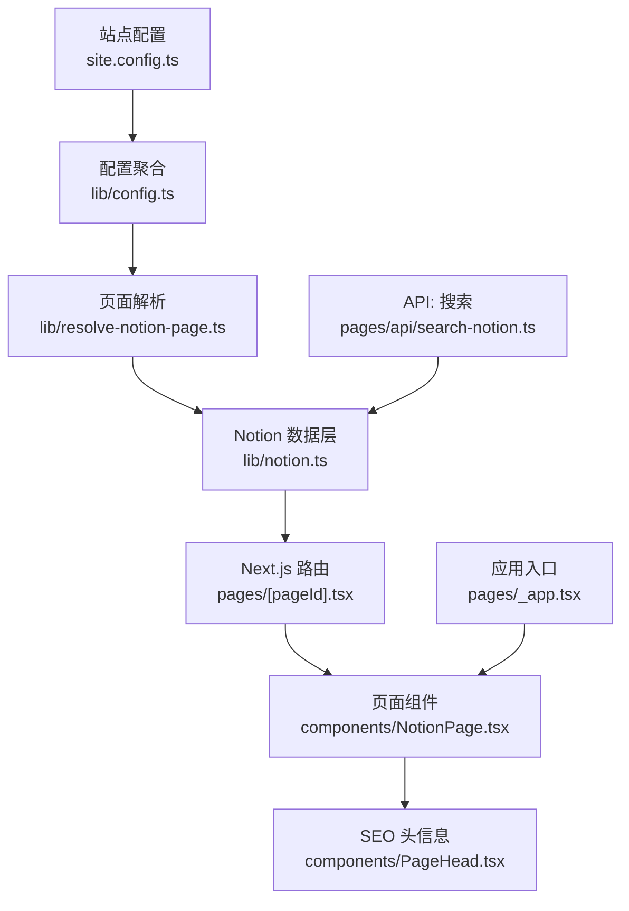
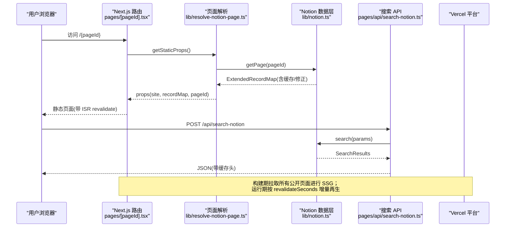
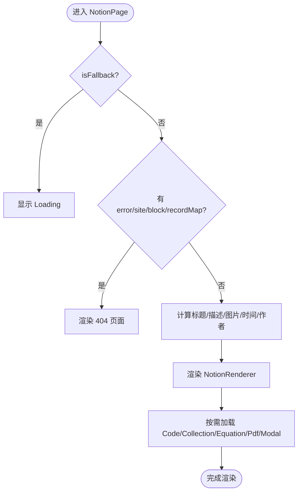
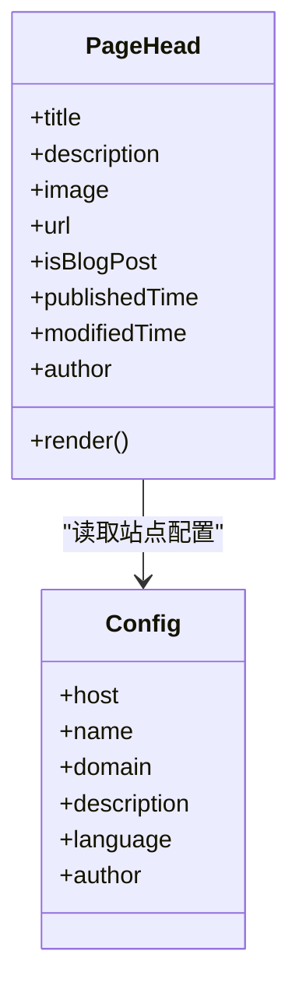
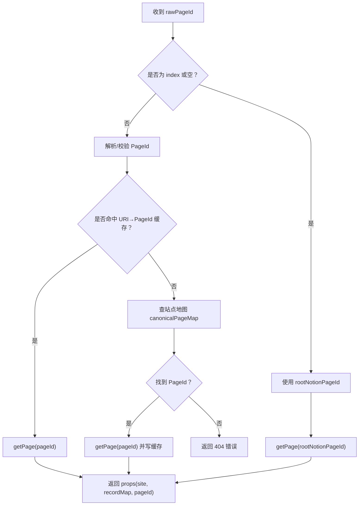
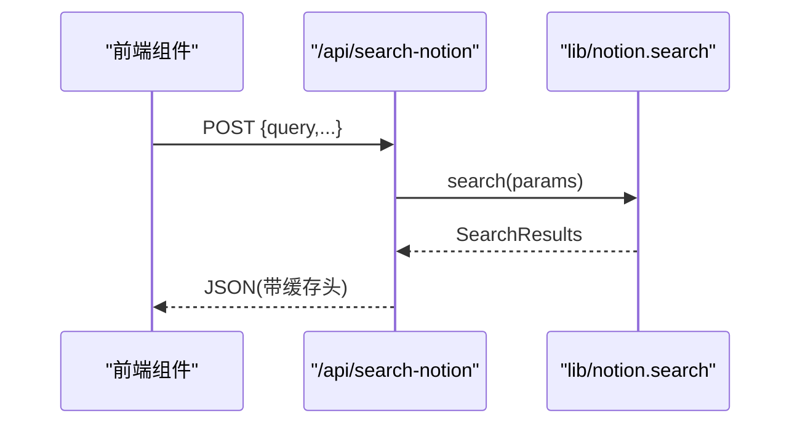
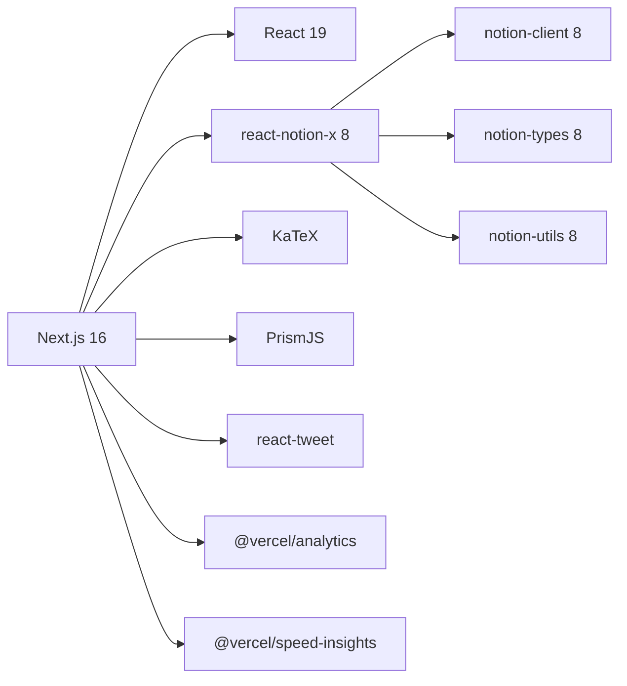

# 项目概述

<cite>
**本文引用的文件**   
- [readme.md](file://readme.md)
- [package.json](file://package.json)
- [next.config.js](file://next.config.js)
- [site.config.ts](file://site.config.ts)
- [lib/config.ts](file://lib/config.ts)
- [lib/site-config.ts](file://lib/site-config.ts)
- [lib/types.ts](file://lib/types.ts)
- [pages/_app.tsx](file://pages/_app.tsx)
- [pages/[pageId].tsx](file://pages/[pageId].tsx)
- [components/NotionPage.tsx](file://components/NotionPage.tsx)
- [components/PageHead.tsx](file://components/PageHead.tsx)
- [lib/notion.ts](file://lib/notion.ts)
- [lib/resolve-notion-page.ts](file://lib/resolve-notion-page.ts)
- [pages/api/search-notion.ts](file://pages/api/search-notion.ts)
- [vercel.json](file://vercel.json)
</cite>

## 目录
1. [简介](#简介)
2. [项目结构](#项目结构)
3. [核心组件](#核心组件)
4. [架构总览](#架构总览)
5. [详细组件分析](#详细组件分析)
6. [依赖分析](#依赖分析)
7. [性能与构建特性](#性能与构建特性)
8. [故障排查指南](#故障排查指南)
9. [结论](#结论)
10. [附录：快速开始与部署](#附录快速开始与部署)

## 简介
本项目是一个基于 Notion 的个人博客系统，使用 Next.js 与 react-notion-x 构建，内容在 Notion 中编写，站点以静态站点生成（SSG）方式输出，并支持增量静态再生（ISR）。技术栈包括 Next.js 16、React 19、TypeScript 7、react-notion-x 8，以及 KaTeX、Prism、react-tweet 等。主要特性包括：
- Notion 内容渲染（代码高亮、公式、PDF、集合视图、推文嵌入等）
- SEO 优化（结构化数据、Open Graph/Twitter Card、站点地图、RSS、搜索引擎验证）
- 全文搜索（通过 API 调用 Notion Search）
- 响应式设计与暗色模式支持
- 预览图（LQIP）与图片优化
- 可配置的导航与页面 URL 映射
- 分析与性能指标集成（Vercel Analytics、Speed Insights、Fathom、PostHog、Clarity）

## 项目结构
- site.config.ts：站点级配置入口（根 Notion 页 ID、域名、作者、SEO、分析、ISR 间隔、导航样式等）
- lib/*：数据层与工具模块（Notion API 客户端、页面解析、站点地图、预览图、URL 映射、搜索、ACL、配置聚合）
- pages/*：Next.js Pages Router 路由（首页、动态页、API 端点、feed、sitemap、robots、404、_app/_document/_error）
- components/*：React UI 组件（NotionPage、头部、SEO Head、搜索弹窗、页脚、评论等）
- styles/*：全局样式与主题覆盖（global.css、notion.css、prism-theme.css）
- public/*：静态资源（图标、清单、验证文件等）

**图表来源**
- [site.config.ts:1-78](file://site.config.ts#L1-L78)
- [lib/config.ts:1-224](file://lib/config.ts#L1-L224)
- [lib/resolve-notion-page.ts:1-85](file://lib/resolve-notion-page.ts#L1-L85)
- [lib/notion.ts:1-219](file://lib/notion.ts#L1-L219)
- [pages/[pageId].tsx:1-36](file://pages/[pageId].tsx#L1-L36)
- [components/NotionPage.tsx:1-357](file://components/NotionPage.tsx#L1-L357)
- [components/PageHead.tsx:1-188](file://components/PageHead.tsx#L1-L188)
- [pages/_app.tsx:1-91](file://pages/_app.tsx#L1-L91)
- [pages/api/search-notion.ts:1-26](file://pages/api/search-notion.ts#L1-L26)

**章节来源**
- [readme.md:81-92](file://readme.md#L81-L92)

## 核心组件
- 站点配置与类型定义
  - site.config.ts：集中管理站点元信息、SEO、分析、ISR、导航等
  - lib/site-config.ts：SiteConfig 接口与工厂函数
  - lib/types.ts：页面属性、站点、站点地图、URL 映射等类型
- 配置聚合
  - lib/config.ts：从站点配置与环境变量聚合运行时配置，暴露 host、api、SEO 标识、分析开关等
- 页面渲染
  - pages/[pageId].tsx：动态路由，使用 getStaticProps + ISR revalidate
  - components/NotionPage.tsx：NotionRenderer 包装、主题、侧边栏、SEO、评论、搜索等
- SEO 与元信息
  - components/PageHead.tsx：标题、描述、OG/Twitter、结构化数据、RSS、canonical 等
- 数据层
  - lib/notion.ts：Notion 页面获取、缓存、集合查询修正、预览图与推文合并
  - lib/resolve-notion-page.ts：URI → PageId 解析、站点地图回退、ACL 注入
- API
  - pages/api/search-notion.ts：封装 Notion Search，带缓存头

**章节来源**
- [site.config.ts:1-78](file://site.config.ts#L1-L78)
- [lib/site-config.ts:1-56](file://lib/site-config.ts#L1-L56)
- [lib/types.ts:1-78](file://lib/types.ts#L1-L78)
- [lib/config.ts:1-224](file://lib/config.ts#L1-L224)
- [pages/[pageId].tsx:1-36](file://pages/[pageId].tsx#L1-L36)
- [components/NotionPage.tsx:1-357](file://components/NotionPage.tsx#L1-L357)
- [components/PageHead.tsx:1-188](file://components/PageHead.tsx#L1-L188)
- [lib/notion.ts:1-219](file://lib/notion.ts#L1-L219)
- [lib/resolve-notion-page.ts:1-85](file://lib/resolve-notion-page.ts#L1-L85)
- [pages/api/search-notion.ts:1-26](file://pages/api/search-notion.ts#L1-L26)

## 架构总览
下图展示从浏览器到 Notion 的完整请求链路，包含 SSR/SSG、ISR、缓存与 API 代理。

**图表来源**
- [pages/[pageId].tsx:8-31](file://pages/[pageId].tsx#L8-L31)
- [lib/resolve-notion-page.ts:11-84](file://lib/resolve-notion-page.ts#L11-L84)
- [lib/notion.ts:161-214](file://lib/notion.ts#L161-L214)
- [pages/api/search-notion.ts:6-25](file://pages/api/search-notion.ts#L6-L25)

## 详细组件分析

### 页面渲染与 Notion 内容渲染
- 动态路由 pages/[pageId].tsx 使用 getStaticProps 拉取 Notion 数据，并通过 revalidate 启用 ISR。开发环境 fallback 为 true，生产环境为 blocking。
- components/NotionPage.tsx 负责：
  - 动态加载可选组件（Code、Collection、Equation、Pdf、Modal）
  - 注入自定义组件（nextImage、nextLink、Tweet、Header、属性格式化）
  - 根据是否博客文章决定是否显示目录
  - 集成 dark mode、lite 模式、搜索、侧边栏、页脚评论
  - 计算 canonical URL、社交图片、描述、发布时间等

**图表来源**
- [components/NotionPage.tsx:211-357](file://components/NotionPage.tsx#L211-L357)
- [pages/[pageId].tsx:8-31](file://pages/[pageId].tsx#L8-L31)

**章节来源**
- [pages/[pageId].tsx:1-36](file://pages/[pageId].tsx#L1-L36)
- [components/NotionPage.tsx:1-357](file://components/NotionPage.tsx#L1-L357)

### SEO 与结构化数据
- components/PageHead.tsx 统一处理：
  - 基础 meta、viewport、主题色、移动端适配
  - robots 与搜索引擎爬虫指令
  - OG/Twitter 卡片、canonical、RSS 订阅
  - 结构化数据（WebSite、BlogPosting），区分文章与网站
  - 根据是否博客文章选择 article:* 字段

**图表来源**
- [components/PageHead.tsx:1-188](file://components/PageHead.tsx#L1-L188)
- [lib/config.ts:51-56](file://lib/config.ts#L51-L56)

**章节来源**
- [components/PageHead.tsx:1-188](file://components/PageHead.tsx#L1-L188)

### 数据层与缓存策略
- lib/notion.ts：
  - 内存缓存 ExtendedRecordMap，TTL 60s，用于吸收突发流量与 Notion 抖动
  - 当 Notion 不可用时返回 stale 缓存，避免全站 500
  - 修正集合视图排序/过滤（重新执行 collection_query）
  - 可选预览图与推文数据合并
- lib/resolve-notion-page.ts：
  - URI → PageId 解析，优先使用 pageUrlOverrides/additions
  - 使用 db 缓存 URI→PageId 映射（一天 TTL）
  - 回退到站点地图 canonicalPageMap
  - 最终注入 ACL 权限控制结果

**图表来源**
- [lib/resolve-notion-page.ts:11-84](file://lib/resolve-notion-page.ts#L11-L84)
- [lib/notion.ts:161-214](file://lib/notion.ts#L161-L214)

**章节来源**
- [lib/notion.ts:1-219](file://lib/notion.ts#L1-L219)
- [lib/resolve-notion-page.ts:1-85](file://lib/resolve-notion-page.ts#L1-L85)

### 搜索功能
- 前端通过 config.isSearchEnabled 决定是否启用搜索
- pages/api/search-notion.ts 接收 POST 请求，转发至 notion.search，并设置缓存头（public, s-maxage=60）
- 搜索结果由 Notion 服务端提供，前端仅做展示

**图表来源**
- [pages/api/search-notion.ts:6-25](file://pages/api/search-notion.ts#L6-L25)
- [lib/notion.ts:216-218](file://lib/notion.ts#L216-L218)

**章节来源**
- [pages/api/search-notion.ts:1-26](file://pages/api/search-notion.ts#L1-L26)
- [lib/notion.ts:216-218](file://lib/notion.ts#L216-L218)

### 应用入口与分析集成
- pages/_app.tsx：
  - 引入 KaTeX、Prism、react-notion-x 样式与全局样式
  - 初始化 Fathom、PostHog、Vercel Analytics、Speed Insights、Clarity
  - 监听路由变化上报 PV

**章节来源**
- [pages/_app.tsx:1-91](file://pages/_app.tsx#L1-L91)

## 依赖分析
- 运行时依赖
  - next 16、react 19、react-dom 19
  - notion-client / notion-types / notion-utils 8.x
  - react-notion-x 8.x
  - katex、prismjs、react-tweet
  - @vercel/analytics、@vercel/speed-insights
  - fathom-client、posthog-js
- 开发依赖
  - typescript 7、oxlint、oxfmt、npm-run-all2
- 构建与打包
  - next.config.js 允许远程图片主机（Notion CDN、AWS、Twitter 等），开启 AVIF/WebP，转译 react-tweet

**图表来源**
- [package.json:27-66](file://package.json#L27-L66)
- [next.config.js:6-24](file://next.config.js#L6-L24)

**章节来源**
- [package.json:1-94](file://package.json#L1-L94)
- [next.config.js:1-43](file://next.config.js#L1-L43)

## 性能与构建特性
- 静态生成与 ISR
  - 构建时拉取所有公开页面进行 SSG
  - 运行期按 revalidateSeconds 增量再生，减少函数调用频率
- 图片优化
  - 允许 Notion CDN 与外部 HTTPS 主机，自动转换为 AVIF/WebP
  - 可选 LQIP 预览图（lqip-modern）
- 代码与数学渲染
  - 按需动态加载 Prism 语法与 KaTeX
- 搜索缓存
  - API 返回缓存头，降低重复查询压力
- 构建超时与回退
  - staticPageGenerationTimeout 提升构建容错
  - Notion 限流（429）时回退到缓存站点地图

**章节来源**
- [readme.md:94-96](file://readme.md#L94-L96)
- [next.config.js:4-24](file://next.config.js#L4-L24)
- [lib/notion.ts:29-55](file://lib/notion.ts#L29-L55)
- [pages/api/search-notion.ts:20-24](file://pages/api/search-notion.ts#L20-L24)

## 故障排查指南
- Notion 不可用或限流
  - 现象：构建或请求失败、429
  - 处理：使用内存缓存返回 stale 数据；构建时回退到缓存站点地图
- 集合视图排序/过滤不一致
  - 现象：列表顺序与 Notion 不一致
  - 处理：fixCollectionQueries 重新执行 query2 并合并结果
- 图片无法加载
  - 现象：远程图片被 Next 优化器拒绝
  - 处理：检查 next.config.js 的 remotePatterns 是否包含对应主机
- 搜索无结果
  - 现象：搜索 API 返回空
  - 处理：确认 Notion 搜索可用、API 方法为 POST、参数正确
- 404 页面
  - 现象：访问不存在的 pageId
  - 处理：resolve-notion-page 返回错误对象，NotionPage 渲染 404

**章节来源**
- [lib/notion.ts:168-182](file://lib/notion.ts#L168-L182)
- [lib/notion.ts:95-159](file://lib/notion.ts#L95-L159)
- [next.config.js:6-24](file://next.config.js#L6-L24)
- [pages/api/search-notion.ts:10-17](file://pages/api/search-notion.ts#L10-L17)
- [lib/resolve-notion-page.ts:66-74](file://lib/resolve-notion-page.ts#L66-L74)
- [components/NotionPage.tsx:255-261](file://components/NotionPage.tsx#L255-L261)

## 结论
该项目将 Notion 作为内容源，结合 Next.js 的 SSG/ISR 能力，提供了高性能、可维护且易于扩展的个人博客方案。通过集中化的站点配置、健壮的数据层与完善的 SEO 支持，既适合初学者快速上手，也满足有经验开发者对性能与可定制性的要求。

## 附录：快速开始与部署
- 前置条件
  - Node.js 24+、pnpm 10+
- 安装与启动
  - pnpm install
  - pnpm dev
  - 打开 http://localhost:3000
- 环境变量
  - 全部可选，本地无需 .env 即可运行
- 站点配置
  - 编辑 site.config.ts，设置 rootNotionPageId、域名、作者、描述、分析、ISR 间隔、导航等
- 脚本命令
  - pnpm build：生产构建
  - pnpm start：启动生产服务
  - pnpm test：并行执行 lint/format/typecheck
  - pnpm deploy：部署到 Vercel
- 部署
  - 平台：Vercel
  - vercel.json 配置每日定时任务调用 /api/indexnow 通知搜索引擎更新索引

**章节来源**
- [readme.md:19-60](file://readme.md#L19-L60)
- [readme.md:94-96](file://readme.md#L94-L96)
- [vercel.json:1-10](file://vercel.json#L1-L10)